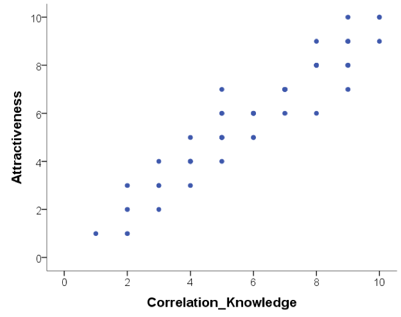
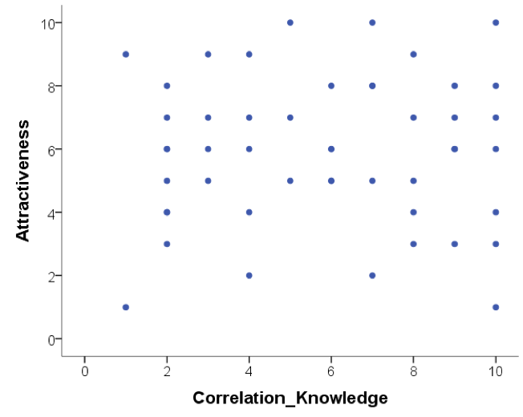
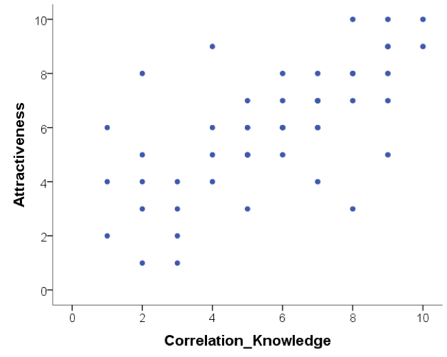
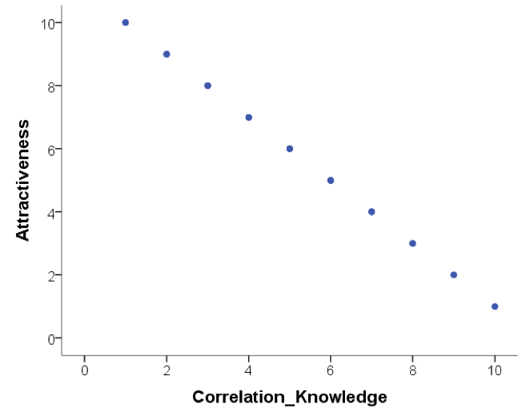

::: {.callout-note title="Overview"}
This week we focus on two strands of learning:

A.  Correlation - how we investigate the association between two numerical variables, visualise patterns using scatterplots, and interpret the direction and strength of a relationship.
B.  Ethical research practice - how we respect participants' choices, collect and protect appropriate data, and interpret and communicate research findings responsibly.

Building on last week’s work with individual numerical variables (e.g. screen time), we will now look at how **two numerical variables** can vary together. We will also consider why an observed association between two variables does not establish causation.

The materials we have prepared to support your learning are arranged in four parts:

-   Lectures
-   Reading
-   Pre-lab activities
-   Lab activities

You can navigate to each in the side bar on the right
:::

<!-- Note: I think it is helpful to have a list of the different sections in a week for cross-referencing. I don't think it helps readability it this is visible to the students (hence I've commented them out) as the outline in the sidebar on the right already provides this info. -->

<!-- - @sec-4141-w4-lectures: Watch these before your lab session -->

<!-- - @sec-4141-w4-lectures-:  -->

<!-- - @sec-4141-w4-lectures-report-correlation: Hypothesis testing and correlation -->

<!-- - @sec-4141-w4-reading: Recommended readings -->

<!-- - @sec-4141-w4-prelab-activities: Activities to do before you attend your lab session -->

<!-- - @sec-4141-w4-lab-activities: Activities you do during your lab session -->

## Lectures {#sec-4141-w4-lectures}

Last week, we explored how psychological concepts can be measured and represented as data. You practised summarising one numerical variable at a time, using measures of central tendency and variability, and created histograms to visualise distributions. We also considered why it is important to look at the data rather than rely on summary statistics alone.

**This week, we move from examining one numerical variable to two**. We will introduce correlation as a measure of association between two variables, create scatterplots, calculate a correlation coefficient in RStudio, and practise interpreting the results.

We will also consider what it means to conduct ethical psychological research, from informed consent and data protection to inclusive recruitment and responsible interpretation. These ideas connect directly to correlation, as finding a relationship between X and Y is not the same as demonstrating that a change in X causes a change in Y.

\newline

::: {.callout-important}
**Please watch the lecture material, complete the essential reading and then the pre-lab activities before attending your lab.** As a reminder, the lectures and pre-labs introduce the concepts and give you some initial practice, and the lab gives you the opportunity to apply these skills in-person with our support.
:::

::: {.callout-tip title="Questions?"}
Make a note of questions as you work through the material. These might be answered later in the recordings, or in your lab. Otherwise, please bring them to the live online Q&A session on Friday or post them on the [Q&A forum on Moodle](https://modules.lancaster.ac.uk/mod/forum/view.php?id=2918081).
:::

### Section A:  {#sec-4141-w4-lectures-}

You can watch the lecture for the video using the video playback windows shown next. Section A is broken into two parts that should be watched in sequence:

1.  Correlation: Theory
2.  Correlation: How to run and report a correlation analysis

**1. Correlation: Theory** (~23 minutes)

What is correlation? How can we describe the direction and strength of a relationship between two numerical variables? Why does correlation not infer causation?

```{r}
#| label: Do not remove. It prevents Quarto from thinking it needs to involve Python.
```

```{=html}

```

\newline

[Correlation: Theory slides](files/week3/4141_wk3_correlation_slides.pdf){download="4141_wk3_correlation_slides.pdf"}.

[Correlation: Theory transcript](files/week3/4141_wk3_correlation_transcript.txt){download="4141_wk3_correlation_transcript.txt"}.


::: {.callout-tip title="Take a break!"}
Before continuing, we recommend you take a **15-minute break away from your computer**. Remember to note down any questions to bring to the Q&A, lab or discussion forum whilst you’re watching the lectures.
:::

### Section B: How to apply hypothesis testing to correlation and report a correlation analysis {#sec-4141-w4-lectures-report-correlation}

Section B has one part:

**1. How to report a correlation analysis** (~ minutes)

How to apply the hypothesis testing framework to correlation and report the results of a correlation analysis following APA conventions.

[How to report correlation: slides](files/week4/4141_howto_reportcorrelation_slides.pdf){download="4141_howto_reportcorrelation_slides.pdf"}.

[How to report correlation: transcript](files/week4/4141_howto_reportcorrelation_transcript.txt){download="4141_4141_howto_reportcorrelation_transcript.txt"}.

::: {.callout-note title="APA Style"}
APA stands for the American Psychological Association. APA style provides shared conventions and guidelines for how to write a research report in psychology. This includes how to report statistical results clearly and consistently. You can read about the APA style (7th edition) [here](https://apastyle.apa.org){target="_blank" rel="noopener"}. A useful summary on reporting numbers and statists in APA style can be found [here](files/week3/apa_report_stats.pdf){download="apa_numbers-statistics-guide.pdf"}).
:::

## Reading {#sec-4141-w4-reading}

::: {.callout-tip title="Easy access to readings"}
All reading is accessible via the library. You can go to Moodle -\> Library Resources -\> Resource List or you can follow [**this link**](https://lancaster.alma.exlibrisgroup.com/leganto/nui/lists/93496942590001221). Readings have one of the following tags:

-   **Essential**: We expect you to be familiar with these reading. You will be assessed on this.
-   **Recommended**: We highly recommend these readings. They often provide a different perspective, or explain things in a different way.
-   **Optional**: Further readings for those interested.

The reading list is divided into multiple sections:

-   **Reading associated with statistics**: this contains links to readings useful for the development of statistical concepts and skills. The main textbook *Fundamental statistics for the behavioral sciences* by Howell (Essential) lives here.
-   **Reading associated with psychological research principles and design**: this contains links to readings that provide a good basis for foundational knowledge around research design.
-   **Reading associated with Open Science principles and practices**: this contains links to key literature on the Open Science movement.
-   **Week by week**: these contain links to key reading for that week that are not listed on any of the more general lists above.
:::

For **week 4**, the reading is:

-   Howell, D. C. (2017). Fundamental statistics for the behavioral sciences (9th ed.). Cengage Learning. Chapter 9. **Essential** Focus on sections 9.10 and 9.11. These sections support the concepts introduced in the pre-recorded lecture on applying the hypothesis testing framework to correlation and reporting the results correctly.

## Pre-lab activities {#sec-4141-w4-prelab-activities}

The lecture material is designed to deliver important ideas and procedures for learning about psychological science and analysis. Pre-lab material is then designed to help consolidate this learning, or enhance, expand and apply it in ways that set the scene for the lab session activity. We want to prepare you to be ready to go in the session itself and make the most of your time there.

These short activities will help you connect Week 2’s emphasis on data visualisation to this week’s work with understanding relationships between two numerical variables.

### Pre-lab activity 1: Why visualise data? Anscombe’s quartet

Last week, we considered the importance of visualising your data and not to just rely on the summary numbers. These measures of central tendency (e.g., mean, median, mode) are also referred to as ‘descriptive statistics’ or ‘summary statistics’. This is because we use them to summarise and describe our data, but we do not use them to make any inferences about our data.

Anscombe’s quartet (1973) showed that four different sets of bivariate data (where X and Y are both recorded for each participant) with **very similar summary statistics** (including means, variances and Pearson correlation coefficients) can look **very different when plotted**. You can read more about this and explore the four plots [**here**](https://en.wikipedia.org/wiki/Anscombe%27s_quartet){target="_blank" rel="noopener"}.

Look closely at the plots. Which one looks approximately linear? Which shows a curved pattern? Where does a single unusual observation have a particularly strong influence?

::: {.callout-note title="Takeaway"}
A correlation coefficient is useful, but looking at a scatterplot helps us spot features that one number cannot show.
:::

### Pre-lab activity 2: Visualising correlations interactively

Have a look at [**this visualisation of correlations**](https://rpsychologist.com/correlation/){target="_blank" rel="noopener"} by Kristoffer Magnusson.

After having read the relevant sections of Howell (2017) Chapter 9 (see under [Reading](#sec-4141-w3-reading)), use this visualisation page to visually replicate the scatterplots in Figures 9.1 and 9.2 - use a sample of 100. After that, visually replicate the scatterplots in Figure 9.3.

Each time you change the correlation, pay attention to the shared variance (the overlap between the two variables, based on R²) and see how this changes with the changing level of relationship between the two variables. The greater the shared variance, the stronger the relationship.

Also, try setting the correlation to r = .5 and then moving a single dot to see how one data point, a potential outlier, can change the stated correlation value between two variables.


### Pre-lab activity 3: Guess the correlation

Try this [**online app on guessing the correlation**](https://www.rossmanchance.com/applets/2021/guesscorrelation/GuessCorrelation.html){target="_blank" rel="noopener"}.

This allows you to see how accurately you can estimate r (correlation strengths) from a scatterplot. Click on “Track Performance” first so you can keep an overview of your overall bias to underestimate or overestimate the strength of a correlation.

Is this all just a bit of fun? Well, yes, because stats is actually fun, and no, because it serves a purpose of helping you determine if the correlations you see in your own data are real, and to help you see if correlations in published research match with what you are being told. As you will have seen from the above examples, one data point can lead to a misleading relationship and even what might be considered a medium to strong relationship may actually have only limited relevance in the real world. It is our responsibility as psychological scientists to interpret our findings appropriately and to not overstate our results. We will think more about this in the lab this week.

## Lab activities {#sec-4141-w4-lab-activities}

<!-- Information on the lab activities will follow soon. -->

### Lab activity 1: Finish lab activities from previous weeks (Recap - skip if completed succesfully last week)

#### Background
Over the past few weeks, we worked with some publicly available data from a research project on mind wandering. You can have a look at the questionnaire [here](files/week1/BMW-3_eng.pdf).

If you did not successfully finish the lab activities for weeks 1, 2 or 3, you may want to complete these first. You can log into the R server, open your project (the `.Rproj` file) and open the Quarto file (ending with `.qmd`) to continue to work through these.

#### Aims of the activity
Ensure you are familiar with reading in a `.csv`-file, creating a histogram anc calculating summary statistics.

#### Steps

1. Login to the R-server
2. Click on the R-project (the `Rproj`) file to open it
3. In the Files tab (right bottom quadrant), navigate to the example script for that week's lab activities. This is the Quarto file (ending with `.qmd`). Click on it to open it.
4. Complete any remaining activities

### Lab activity 2: Hypothesis testing for correlation

#### Background

Last week, we worked with some publicly available data from a research project on mind wandering. Anna Schubert and colleagues (Schubert et al., 2024) conducted a study in which they created a 12-item questionnaire that measures how often your mind wanders without meaning to, how often you let it wander on purpose, and how aware you are when it happens. You can have a look at the questionnaire [here](files/week1/BMW-3_eng.pdf). This week, we'll revisit how to create a histogram and then calculate descriptive statistics for the questionnaire responses.

**Reference**

Schubert, A.-L., Frischkorn, G. T., Sadus, K., Welhaf, M. S., Kane, M. J., & Rummel, J. (2024). The brief mind wandering three-factor scale (BMW-3). *Behavior Research Methods, 56*(8), 8720-8744. [https://doi.org/10.3758/s13428-024-02500-6](https://doi.org/10.3758/s13428-024-02500-6){target="_blank" rel="noopener"}

#### Aims of the activity

We are going to:

1.  Download and organise your files
2.  Setup the appropriate bits and pieces in RStudio
3.  Read in the data
4.  Build scatterplots with `geom_point()`, and add a line of best fit using `geom_smooth()`
5.  Calculate and interpret Pearson's r using `correlation()`

#### Step 1: Download the files
To complete this lab activity you will need two files:

1.  We'll work with an example script called `4141_wk3_lab.qmd`. This is a Quarto document.
2.  We need a data file called `data_bmw3_subscales.csv`. This is a file that contains the responses of the participants in one of the studies reported on in the paper by Schubert et al. (2024). It is a file of the type `.csv`. This means that individual bits of data are separated by comma's. We'll often use `.csv` files.

You can download the files here: [`4141_wk4_lab.zip`](files/week3/4141_wk4_lab.zip){download="4141_wk4_lab.zip"}. Usually they will be saved in your 'Downloads' folder.

Next, upload the zip-folder as it is to your Files space on the R-server (bottom right quadrant; no need to extract the files first).

Finally, open the example script by clicking on the file called `4141_wk3_lab.qmd` in the Files space on the R-server.

#### Steps 2 to 6

For **steps 2 to 6**, you'll be working in RStudio.

### Lab activity 3: Interpreting correlation

#### Question 1

Below are scatterplots that show the relationship between 'how much you know about correlation and how attractive you appear to members of the opposite (&/or same) sex'. Choose the type of correlation (strength and direction) displayed in each graph using one of the following:

-   Perfect positive correlation
-   Perfect negative correlation
-   Strong positive correlation
-   Strong negative correlation
-   Moderate positive correlation
-   Moderate negative correlation
-   Null correlation

**Figure A** 

**Figure B** 

**Figure C** 

**Figure D** 

::: {.callout-note}
For the following questions, explain your chosen answer based on the statistic given, not on why you think the correlation may or may note make 'logical' sense.
:::

#### Question 2

Suppose it was observed that there is a correlation of r = -.81 between a driver's age and the cost of car insurance. This correlation would mean that, in general, older people pay more for car insurance.

**TRUE or FALSE? Explain why.**

#### Question 3

Suppose that there is a correlation of r = .87 between the length of time a person is in prison and the amount of aggression the person displays on a psychological inventory administered at release. This means that spending a longer amount of time in prison *causes* people to become more aggressive.

**TRUE or FALSE? Explain why.**

#### Question 4

A significant correlation was found between having great hair and performance in research methods and stats labs. The correlation coefficient was .7. How much variance in research methods and stats lab performance can the 'greatness' of your hair explain?

-   51%
-   70%
-   49%
-   30%
-   Who cares I've got great hair.

What was the reason for your answer?

There is a name for the coefficient that reflects how much variance in one variable can be explained by the other variable. What is this coefficient called?

## Answers

*The answers to the questions will be available after the final lab session has taken place.*

<!-- ### Lab activity 3: Interpreting correlation -->

<!-- 1.  Below are scatterplots that show the relationship between 'how much you know about correlation and how attractive you appear to members of the opposite (&/or same) sex'. Choose the type of correlation (strength and direction) displayed in each graph. -->

<!-- ::: {.callout-note icon=false collapse="true"} -->
<!-- ## Answer -->

<!-- a.  strong positive correlation -->
<!-- b.  null correlation -->
<!-- c.  moderate positive correlation -->
<!-- d.  perfect negative correlation -->

<!-- ::: -->


<!-- 2. Suppose it was observed that there is a correlation of *r* = -.81 between a driver's age and the cost of car insurance. This correlation would mean that, in general, older people pay more for car insurance. -->

<!-- ::: {.callout-note icon=false collapse="true"} -->
<!-- ## Answer -->
<!-- FALSE Explanation: The correlation coefficient is negative and therefore infers a negative correlation. As such, older people pay less for car insurance: as age increases, car insurance costs decrease. -->
<!-- ::: -->

<!-- 3. Suppose that there is a correlation of *r* = .87 between the length of time a person is in prison and the amount of aggression the person displays on a psychological inventory administered at release. This means that spending a longer amount of time in prison *causes* people to become more aggressive. -->

<!-- ::: {.callout-note icon=false collapse="true"} -->
<!-- ## Answer -->
<!-- FALSE Explanation: This is a bit of trick question as it has the sneaky 'cause' word in. The correlation coefficient is a positive number, suggesting a positive relationship between length of time in prison and aggression. However, causation cannot be inferred from correlation and therefore we cannot know whether time spent in prison CAUSES aggression, and rather we suggest a relationship between the two: as length of time in prison increases, aggression increases. -->
<!-- ::: -->

<!-- 4. A significant correlation was found between having great hair and performance in research methods and stats labs. The correlation coefficient was .7. How much variance in research methods and stats lab performance can the 'greatness' of your hair explain? -->

<!-- ::: {.callout-note icon=false collapse="true"} -->
<!-- ## Answer -->
<!-- c 49% The 'coefficient of determination' or 'R-squared' tells us the proportion or variance in one variable that can be predicted if we know the other variable. We can determine this by squaring the *r*. Therefore, .7^2^ = .49, *R^2^* = .49. -->
<!-- ::: -->
