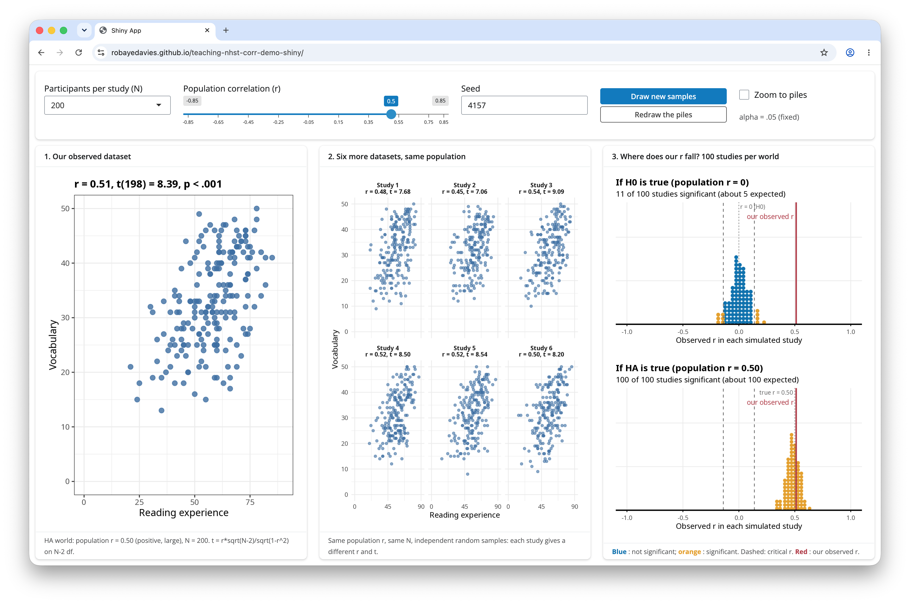

```{r}
#| eval: true
#| echo: false
#| warning: false
#| message: false

# -- get libraries
library(correlation)
library(here)
library(patchwork)
library(tidyverse)

# -- read in data
thirty <- read_csv("correlation-data-n030.csv")
hundred <- read_csv("correlation-data-n100.csv")
thousand <- read_csv("correlation-data-n1000.csv")
```

::: {.callout-note title="Overview"}
This week we focus on two strands of learning:

A.  Hypothesis testing and significance testing and how we think about evidence in the context of correlation analysis
B.  Getting started on the group project: Getting into groups and planning the project

Building on last week’s work on how **two numerical variables** can vary together, **this week** we will apply hypothesis testing and significance testing to correlation analysis.

We will also start the group project in which you will investigate the question: *Is mind wandering related to screen time?*

The materials we have prepared to support your learning are arranged in four parts:

-   Lectures
-   Reading
-   Pre-lab activities
-   Lab activities

You can navigate to each in the side bar on the right
:::

<!-- Note: I think it is helpful to have a list of the different sections in a week for cross-referencing. I don't think it helps readability it this is visible to the students (hence I've commented them out) as the outline in the sidebar on the right already provides this info. -->

<!-- - @sec-4141-w4-lectures: Watch these before your lab session -->

<!-- - @sec-4141-w4-lectures-theory:  -->

<!-- - @sec-4141-w4-lectures-report-correlation: Hypothesis testing and correlation -->

<!-- - @sec-4141-w4-lectures-project: An overview of the project -->

<!-- - @sec-4141-w4-reading: Recommended readings -->

<!-- - @sec-4141-w4-prelab-activities: Activities to do before you attend your lab session -->

<!-- - @sec-4141-w4-lab-activities: Activities you do during your lab session -->

## Lectures {#sec-4141-w4-lectures}

Last week, we explored how two measures can vary together. You practised visualising the relationship using scatterplots and estimating Pearson's $r$. We also talked about how we respect participants' choices, collect and protect appropriate data, and interpret and communicate research findings responsibly.

**This week, we learn about hypothesis testing and significance testing** and apply this to correlation analysis. We will also practise reporting correlation analysis following APA conventions.

We will make a start with the group project.

\newline

::: {.callout-important}
**Please watch the lecture material, complete the essential reading and then the pre-lab activities before attending your lab.** As a reminder, the lectures and pre-labs introduce the concepts and give you some initial practice, and the lab gives you the opportunity to apply these skills in-person with our support.
:::

::: {.callout-tip title="Questions?"}
Make a note of questions as you work through the material. These might be answered later in the recordings, or in your lab. Otherwise, please bring them to the live online Q&A session on Friday or post them on the [Q&A forum on Moodle](https://modules.lancaster.ac.uk/mod/forum/view.php?id=2918081).
:::

### Section A: Hypothesis testing, significance testing  {#sec-4141-w4-lectures-theory}

You can watch the lecture for the video using the video playback windows shown next. 
Our lecture on hypothesis testing and significance testing, shown next, is split into six short parts that you should watch in sequence.

<!-- 1.  Hypothesis testing and significance testing -->

<!-- 2.  Correlation: How to report a correlation analysis -->

**1. Hypothesis testing and significance testing** (~70 minutes in total)

You can download the lecture slides as a .html file you can open in any browser.

The slides end with a references list but don't worry about reading what's in the references list, we give you recommended readings in @sec-4141-w4-reading.

::: callout-tip
The slides presented in the next videos can be downloaded as a web page: `hypothesis-testing-significance.html.` 

- [Lecture slides](files/week4/hypothesis-testing-significance.html)

When you download the file, double click on it to open it in your usual web browser for viewing.

There are many slides but not all slides are discussed in-depth in the lecture, some are there to help to visually support transitions between points.
:::

Next, you can see the lecture elements. We recommend that you watch them in the order they are shown in.

1.1. **We are going to learn about hypothesis or significance testing** (~5 minutes). This is a challenging topic. We can meet this challenge by enriching our perspectives to take in historical, philosophical, and psychological viewpoints.

\newline

```{=html}
<div style="position: relative; width: 100%; height: 0; padding-bottom: 56.25%">
	<iframe src="https://lancaster.cloud.panopto.eu/Panopto/Pages/Embed.aspx?id=e97ccec1-994f-4155-aaeb-b4ec00d15ba1&autoplay=false&offerviewer=true&showtitle=true&showbrand=true&captions=false&start=0&interactivity=all" style="border: 1px solid #464646; position: absolute; top: 0; left: 0; width: 100%; height: 100%; box-sizing: border-box;" allowfullscreen allow="autoplay" aria-label="Panopto Embedded Video Player" aria-description="nhst-one"></iframe>
</div>
```

\newline

1.2. **What is NHST and where does it come from?** (~13 minutes). We are going to learn about hypothesis testing and significance from two different perspectives: (1.) The perspective of an individual researcher, asking what they can learn from the evidence from their study. (2.) The perspective of someone looking at errors that we (in general) could make as we make decisions based on the evidence from multiple repeated studies. We begin with the first perspective, based on Ronald Fisher's ideas.

```{=html}
<div style="position: relative; width: 100%; height: 0; padding-bottom: 56.25%">
	<iframe src="https://lancaster.cloud.panopto.eu/Panopto/Pages/Embed.aspx?id=c4c1f0fa-3673-48e2-ae62-b4ec00d344fc&autoplay=false&offerviewer=true&showtitle=true&showbrand=true&captions=false&interactivity=all" style="border: 1px solid #464646; position: absolute; top: 0; left: 0; width: 100%; height: 100%; box-sizing: border-box;" allowfullscreen allow="autoplay" aria-label="Panopto Embedded Video Player" aria-description="nhst-two"></iframe>
</div>
```

\newline

1.3. **Demonstration: significance testing** (~20 minutes). We have outlined the logic of the significance test in words. But it is often easier to understand the logic if we see how the ideas work in practice.

```{=html}
<div style="position: relative; width: 100%; height: 0; padding-bottom: 56.25%">
	<iframe src="https://lancaster.cloud.panopto.eu/Panopto/Pages/Embed.aspx?id=31051ec9-183a-4001-8f88-b4ec00ddd8d4&autoplay=false&offerviewer=true&showtitle=true&showbrand=true&captions=false&interactivity=all" style="border: 1px solid #464646; position: absolute; top: 0; left: 0; width: 100%; height: 100%; box-sizing: border-box;" allowfullscreen allow="autoplay" aria-label="Panopto Embedded Video Player" aria-description="nhst-three-revised"></iframe>
</div>
```

\newline

1.4. **Hypothesis testing** (~10 minutes). We switch to a different philosophy and a different view of the psychology of researchers. We take a second perspective, grounded in thinking about error rates, based on the ideas of Jerzy Neyman and Egon Pearson.

```{=html}
<div style="position: relative; width: 100%; height: 0; padding-bottom: 56.25%">
	<iframe src="https://lancaster.cloud.panopto.eu/Panopto/Pages/Embed.aspx?id=eb63ea9a-9779-460b-9ace-b4ec00e416dc&autoplay=false&offerviewer=true&showtitle=true&showbrand=true&captions=false&interactivity=all" style="border: 1px solid #464646; position: absolute; top: 0; left: 0; width: 100%; height: 100%; box-sizing: border-box;" allowfullscreen allow="autoplay" aria-label="Panopto Embedded Video Player" aria-description="nhst-four"></iframe>
</div>
```

\newline

1.5. **Seeing the Neyman-Pearson approach at work** (24 minutes). To help us to build understanding, we work through demonstrations that build on realistic simulations of the kind of evidence we collect in psychological studies of correlation.

```{=html}
<div style="position: relative; width: 100%; height: 0; padding-bottom: 56.25%">
	<iframe src="https://lancaster.cloud.panopto.eu/Panopto/Pages/Embed.aspx?id=1dc19dad-6e89-4bd1-8c72-b4ec00e86063&autoplay=false&offerviewer=true&showtitle=true&showbrand=true&captions=false&interactivity=all" style="border: 1px solid #464646; position: absolute; top: 0; left: 0; width: 100%; height: 100%; box-sizing: border-box;" allowfullscreen allow="autoplay" aria-label="Panopto Embedded Video Player" aria-description="nhst-five"></iframe>
</div>
```

\newline

1.6. **Summary** (8 minutes). Two ways of thinking clearly about evidence. The impacts on how we write about and think about research as psychologists.

```{=html}
<div style="position: relative; width: 100%; height: 0; padding-bottom: 56.25%">
	<iframe src="https://lancaster.cloud.panopto.eu/Panopto/Pages/Embed.aspx?id=4efc9b0e-5c11-4043-993f-b4ec00efe2f3&autoplay=false&offerviewer=true&showtitle=true&showbrand=true&captions=false&interactivity=all" style="border: 1px solid #464646; position: absolute; top: 0; left: 0; width: 100%; height: 100%; box-sizing: border-box;" allowfullscreen allow="autoplay" aria-label="Panopto Embedded Video Player" aria-description="nhst-six"></iframe>
</div>
```

<!-- **2. How to report a correlation analysis** (~ minutes) -->

<!-- How to apply the hypothesis testing framework to correlation and report the results of a correlation analysis following APA conventions. -->

<!-- [How to report correlation: slides](files/week4/4141_howto_reportcorrelation_slides.pdf){download="4141_howto_reportcorrelation_slides.pdf"}. -->

<!-- [How to report correlation: transcript](files/week4/4141_howto_reportcorrelation_transcript.txt){download="4141_4141_howto_reportcorrelation_transcript.txt"}. -->

<!-- ::: {.callout-note title="APA Style"} -->
<!-- APA stands for the American Psychological Association. APA style provides shared conventions and guidelines for how to write a research report in psychology. This includes how to report statistical results clearly and consistently. You can read about the APA style (7th edition) [here](https://apastyle.apa.org){target="_blank" rel="noopener"}. A useful summary on reporting numbers and statists in APA style can be found [here](files/week3/apa_report_stats.pdf){download="apa_numbers-statistics-guide.pdf"}). -->
<!-- ::: -->

::: {.callout-tip title="Take a break!"}
Before continuing, we recommend you take a **15-minute break away from your computer**. Remember to note down any questions to bring to the Q&A, lab or discussion forum whilst you’re watching the lectures.
:::

<!-- ### Section B: An overview of the project {#sec-4141-w4-lectures-project} -->

<!-- Section B has one part: -->

<!-- **1. The project: An overview** (~ minutes) -->

<!-- An overview of the project you will carry out and the research report you will write. -->

<!-- ```{=html} -->

<!-- ``` -->

<!-- \newline -->

<!-- [Project overview - slides](files/week4/4141_wk4_project_slides.pdf){download="4141_wk4_project_slides.pdf"}. -->

<!-- [Project overview - transcript](files/week4/4141_wk4_project_transcript.txt){download="4141_wk4_project_transcript.txt"}. -->

## Reading {#sec-4141-w4-reading}

::: {.callout-tip title="Easy access to readings"}
All reading is accessible via the library. You can go to Moodle -\> Library Resources -\> Resource List or you can follow [**this link**](https://lancaster.alma.exlibrisgroup.com/leganto/nui/lists/93496942590001221). Readings have one of the following tags:

-   **Essential**: We expect you to be familiar with these reading. You will be assessed on this.
-   **Recommended**: We highly recommend these readings. They often provide a different perspective, or explain things in a different way.
-   **Optional**: Further readings for those interested.

The reading list is divided into multiple sections:

-   **Reading associated with statistics**: this contains links to readings useful for the development of statistical concepts and skills. The main textbook *Fundamental statistics for the behavioral sciences* by Howell (Essential) lives here.
-   **Reading associated with psychological research principles and design**: this contains links to readings that provide a good basis for foundational knowledge around research design.
-   **Reading associated with Open Science principles and practices**: this contains links to key literature on the Open Science movement.
-   **Week by week**: these contain links to key reading for that week that are not listed on any of the more general lists above.
:::

For **week 4**, the reading is:

-   Howell, D. C. (2017). Fundamental statistics for the behavioral sciences (9th ed.). Cengage Learning. Chapter 9. **Essential** 
- Focus on sections 9.10 and 9.11. These sections support the concepts introduced in the pre-recorded lecture on applying the hypothesis testing framework to correlation and reporting the results correctly.

## Pre-lab activities {#sec-4141-w4-prelab-activities}

The lecture material is designed to deliver important ideas and procedures for learning about psychological science and analysis. Pre-lab material is then designed to help consolidate this learning, or enhance, expand and apply it in ways that set the scene for the lab session activity. We want to prepare you to be ready to go in the session itself and make the most of your time there.

These short activities will help you to connect Week 4’s emphasis on estimating correlations with sample data in `R` to this week’s work on hypothesis testing and significance.

::: callout-tip
Information on the pre-lab activities will follow soon.
:::

### Pre-lab activity 1: Visualising correlations interactively

Last week, we worked on how you can examine the potential associations between variables: 

- visualizing potential associations between variables using scatterplots;
- estimating the associations as correlations $r$.

We showed you a couple of web apps you can use to visualize potential associations. We add a **new** one for this week.

::: callout-tip
Make sure you have tried these apps out.

- The purpose of playing with these apps is quite serious: you are training your visualization skills, and tuning your intuitions. The only way to do this is by looking at lots of plots.
:::

1. Have a look at [**this visualisation of correlations**](https://rpsychologist.com/correlation/){target="_blank" rel="noopener"} by Kristoffer Magnusson.

After having read the relevant sections of Howell (2017) Chapter 9 (see under [Reading](#sec-4141-w3-reading)), use this visualisation page to visually replicate the scatterplots in Figures 9.1 and 9.2 - use a sample of 100. After that, visually replicate the scatterplots in Figure 9.3.

Each time you change the correlation, pay attention to the shared variance (the overlap between the two variables, based on R²) and see how this changes with the changing level of relationship between the two variables. The greater the shared variance, the stronger the relationship.

Also, try setting the correlation to r = .5 and then moving a single dot to see how one data point, a potential outlier, can change the stated correlation value between two variables.

2. Try the [**online app on guessing the correlation**](https://www.rossmanchance.com/applets/2021/guesscorrelation/GuessCorrelation.html){target="_blank" rel="noopener"}.

This allows you to see how accurately you can estimate r (correlation strengths) from a scatterplot. Click on “Track Performance” first so you can keep an overview of your overall bias to underestimate or overestimate the strength of a correlation.

3. **New**: Try this [**Guessing correlation coefficients app**](https://shiney.zoology.ubc.ca/whitlock/Guessing_correlation/){target="_blank" rel="noopener"} because it doesn't hurt to look at a different kind of app.

## Lab activities {#sec-4141-w4-lab-activities}

<!-- ::: callout-tip -->
<!-- Information on the lab activities will follow soon. -->
<!-- ::: -->

### Lab activity 1: Finish lab activities from previous weeks (Recap - skip if completed successfully last week)

#### Background
Over the past few weeks, we worked with some publicly available data from a research project on mind wandering. You can have a look at the questionnaire [here](files/week1/BMW-3_eng.pdf).

If you did not successfully finish the lab activities for weeks 1, 2 or 3, you may want to complete these first.

You can log into the R server, open your project (the `.Rproj` file) and open the Quarto file (ending with `.qmd`) to continue to work through these.

#### Aims of the activity
Ensure you are familiar with reading in a `.csv`-file, creating a histogram and calculating summary statistics.

#### Steps

1. Login to the R-server
2. Click on the R-project (the `Rproj`) file to open it
3. In the Files tab (right bottom quadrant), navigate to the example script for that week's lab activities. This is the Quarto file (ending with `.qmd`). Click on it to open it.
4. Complete any remaining activities

### Lab activity 2: Hypothesis testing for correlations -- *getting ready*

#### Background

This week, we are going to work with data that we have generated (through simulations) but which are based on data from a real project looking at how psychologists measure vocabulary knowledge.

Hanke Vermeiren and colleagues (Vermeiren et al., 2023) completed a series of studies to develop a vocabulary test for English-speaking university students. Among the tests they developed were measures of vocabulary knowledge (what you know about word meanings) and of reading experience (print exposure, based on recognition of author names). They share information on the tests through the repository: [https://osf.io/ef3s4/overview](https://osf.io/ef3s4/overview){target="_blank" rel="noopener"}.

::: callout-tip
I talk about this study in the lecture on **Hypothesis testing, significance testing** because there are good reasons to think we *might* see correlations between measures of vocabulary knowledge and measures of reading experience.
:::

**Reference**

Vermeiren, H., Vandendaele, A., \& Brysbaert, M. (2023). Validated tests for language research with university students whose native language is English: Tests of vocabulary, general knowledge, author recognition, and reading comprehension. *Behavior Research Methods*, 55(3), 1036–1068. [https://doi.org/10.3758/s13428-022-01856-x](https://doi.org/10.3758/s13428-022-01856-x){target="_blank" rel="noopener"}. 

#### Aims of the activity

We are going to:

1.  Download and organise your files
2.  Setup the appropriate bits and pieces in RStudio
3.  Read in the data
4.  Build scatterplots with `geom_point()` and edit your code to change how the plot looks
5.  Calculate and interpret significance tests for correlation when you use `correlation()`.

#### Download the files

To complete this lab activity you will need *four* files:

1.  We'll work with an example script called `4141_wk4_lab.qmd`. This is a Quarto document.
2.  We need data files called:

- `correlation-data-n030.csv`
- `correlation-data-n100.csv`
- `correlation-data-n1000.csv`

These files all hold scores on tests of vocabulary knowledge or of reading experience. 

- Different (simulated) participants' scores are on different rows of each spreadsheet.
- Different kinds of scores are in different columns of each spreadsheet.

Column names are shown at the top of the columns. The names encode information about what the column data are about in a `[..].[..].[..].[..]` four-part naming scheme:

- `[`what test? vocabulary or experience`].[`is r positive or negative or zero?`].[`is r large, medium, small in size?`].[`how big is the participant sample? small (30) medium (100) large (1000)`]`

:::  {.callout-note collapse="true"}
## Click here for examples of  column names
The columns have names that look like this (from `correlation-data-n100.csv`):

- `vocab.neg.lar.med` -- vocabulary.negative.large.medium
- `exper.neg.lar.med`	-- experience.negative.large.medium

- `vocab.neg.med.med`	-- vocabulary.negative.medium.medium
- `exper.neg.med.med`	-- experience.negative.medium.medium	

- `vocab.neg.sma.med`	-- vocabulary.negative.small.medium	
- `exper.neg.sma.med`	-- experience.negative.small.medium	

- `vocab.zer.zer.med`	-- vocabulary.zero.zero.medium	
- `exper.zer.zer.med`	-- experience.zero.zero.medium	

- `vocab.pos.sma.med`	-- vocabulary.positive.large.medium	
- `exper.pos.sma.med`	-- experience.positive.large.medium	

- `vocab.pos.med.med`	-- vocabulary.positive.medium.medium	
- `exper.pos.med.med`	-- experience.positive.medium.medium	

- `vocab.pos.lar.med`	-- vocabulary.positive.small.medium	
- `exper.pos.lar.med`	-- experience.positive.small.medium
:::

You can download the files here: [`4141_wk4_lab.zip`](files/week4/4141_wk4_lab.zip){download="4141_wk4_lab.zip"}. Usually they will be saved in your 'Downloads' folder.

Next, upload the zip-folder as it is to your Files space on the R-server: Look at bottom right quadrant of the R-server web window. There is no need to extract the files first.

Finally, open the example script by clicking on the file called `4141_wk4_lab.qmd` in the Files space on the R-server.

::: callout-tip
From now on, you'll be working in RStudio.
:::

### Lab activity 3: Beautifying scatterplots

#### Information

We begin by working on edits to change or improve the look of your scatterplots.

You will often need to change things like:

**The colour of points**

```{r}
#| eval: true
#| echo: false
#| warning: false
#| message: false
#| information: false
#| fig-cap: "Scatterplots showing the relationship between reading experience and vocabulary. Points vary in colour"
#| fig-width: 9
#| fig-height: 4
#| label: fig-scatter-colour

thirty.green <- ggplot(data = thirty, aes(x = exper.pos.sma.sma, y = vocab.pos.sma.sma)) +
  geom_point(colour = "limegreen") +
  labs(x = "experience", y = "vocabulary") +
  theme_bw()

thirty.purple <- ggplot(data = thirty, aes(x = exper.pos.sma.sma, y = vocab.pos.sma.sma)) +
  geom_point(colour = "purple") +
  labs(x = "experience", y = "vocabulary") +
  theme_bw()
  
thirty.orange <- ggplot(data = thirty, aes(x = exper.pos.sma.sma, y = vocab.pos.sma.sma)) +
  geom_point(colour = "orange") +
  labs(x = "experience", y = "vocabulary") +
  theme_bw()
  
thirty.green + thirty.purple + thirty.orange
```

:::  {.callout-note collapse="true"}
## Click here to see how to change the colour of points

The important change is to add colour: `geom_point(colour = ...)`

```{r}
#| eval: false
ggplot(data = thirty, aes(x = exper.pos.sma.sma, y = vocab.pos.sma.sma)) +
  geom_point(colour = "limegreen") +
  labs(x = "experience", y = "vocabulary") +
  theme_bw()
```
:::

**The size of points**

```{r}
#| eval: true
#| echo: false
#| warning: false
#| message: false
#| information: false
#| fig-cap: "Scatterplots showing the relationship between reading experience and vocabulary. Points vary in size"
#| fig-width: 9
#| fig-height: 4
#| label: fig-scatter-size

thirty.small <- ggplot(data = thirty, aes(x = exper.pos.sma.sma, y = vocab.pos.sma.sma)) +
  geom_point(size = .5) +
  labs(x = "experience", y = "vocabulary") +
  theme_bw()

thirty.medium <- ggplot(data = thirty, aes(x = exper.pos.sma.sma, y = vocab.pos.sma.sma)) +
  geom_point(size = 2) +
  labs(x = "experience", y = "vocabulary") +
  theme_bw()
  
thirty.large <- ggplot(data = thirty, aes(x = exper.pos.sma.sma, y = vocab.pos.sma.sma)) +
  geom_point(size = 5) +
  labs(x = "experience", y = "vocabulary") +
  theme_bw()
  
thirty.small + thirty.medium + thirty.large
```

:::  {.callout-note collapse="true"}
## Click here to see how to change the size of points

The important change is to add size: `geom_point(size = ...)`

```{r}
#| eval: false
ggplot(data = thirty, aes(x = exper.pos.sma.sma, y = vocab.pos.sma.sma)) +
  geom_point(size = 5) +
  labs(x = "experience", y = "vocabulary") +
  theme_bw()
```
:::

**The transparency of points**

```{r}
#| eval: true
#| echo: false
#| warning: false
#| message: false
#| information: false
#| fig-cap: "Scatterplots showing the relationship between reading experience and vocabulary. Points vary in transparency"
#| fig-width: 9
#| fig-height: 4
#| label: fig-scatter-alpha

thirty.default <- ggplot(data = thirty, aes(x = exper.pos.sma.sma, y = vocab.pos.sma.sma)) +
  geom_point(size = 5, alpha = 1) +
  labs(x = "experience", y = "vocabulary") +
  theme_bw()

thirty.dark <- ggplot(data = thirty, aes(x = exper.pos.sma.sma, y = vocab.pos.sma.sma)) +
  geom_point(size = 5, alpha = .75) +
  labs(x = "experience", y = "vocabulary") +
  theme_bw()
  
thirty.light <- ggplot(data = thirty, aes(x = exper.pos.sma.sma, y = vocab.pos.sma.sma)) +
  geom_point(size = 5, alpha = .25) +
  labs(x = "experience", y = "vocabulary") +
  theme_bw()
  
thirty.default + thirty.dark + thirty.light
```

:::  {.callout-note collapse="true"}
## Click here to see how to change the alpha of points

The important change is to add alpha: `geom_point(alpha = ...)` -- `alpha` is how you define how dark (fractions closer to 1) or transparent points are (values closer to 0)

```{r}
#| eval: false
thirty.large <- ggplot(data = thirty, aes(x = exper.pos.sma.sma, y = vocab.pos.sma.sma)) +
  geom_point(size = 5, alpha = .25) +
  labs(x = "experience", y = "vocabulary") +
  theme_bw()
```
:::

::: callout-tip
You often need to *style* plots so they are consistent with the look and feel you want for your business, your group or your self.

- Here, we will need to work transparency (coding `alpha`) because varying transparency of points allows us to deal with over-plotting if there are lots of data points; this is when many points are printed on top of each other and things look crowded.
:::

#### Question 1

Create a scatterplot of the potential association in the `correlation-data-n030.csv` data between the variables: `vocab.pos.sma.sma` and `exper.pos.sma.sma`. Make the points *really* big.

<!-- :::  {.callout-note collapse="true"} -->
<!-- ## Click here to see the answer -->

<!-- The important change is to add size: `geom_point(size = ...)`. Add in the `size = ` and enter a number to define size (any integer). -->

<!-- ```{r} -->
<!-- #| eval: true -->
<!-- #| warning: false -->
<!-- #| message: false -->

<!-- ggplot(data = thirty, aes(x = exper.pos.sma.sma, y = vocab.pos.sma.sma)) + -->
<!--   geom_point(size = 10) + -->
<!--   labs(x = "experience", y = "vocabulary") + -->
<!--   theme_bw() -->
<!-- ``` -->
<!-- ::: -->

#### Question 2

Create a scatterplot of the potential association in the `correlation-data-n030.csv` data between the variables: `vocab.pos.lar.sma` and `exper.pos.lar.sma`. Make the points *really* colourful: whatever colour you like.

<!-- :::  {.callout-note collapse="true"} -->
<!-- ## Click here to see the answer -->

<!-- The important change is to add colour: `geom_point(colour = ...)`. Add in the `colour = ` and enter a normal English colour name. -->

<!-- ```{r} -->
<!-- #| eval: true -->
<!-- #| warning: false -->
<!-- #| message: false -->

<!-- ggplot(data = thirty, aes(x = exper.pos.lar.sma, y = vocab.pos.lar.sma)) + -->
<!--   geom_point(colour = "orange") + -->
<!--   labs(x = "experience", y = "vocabulary") + -->
<!--   theme_bw() -->
<!-- ``` -->
<!-- ::: -->

#### Question 3

Create a scatterplot of the potential association in the `correlation-data-n030.csv` data between the variables: `vocab.neg.med.sma` and `exper.neg.med.sma`. Make the points semi-transparent: whatever level of alpha you like.

<!-- :::  {.callout-note collapse="true"} -->
<!-- ## Click here to see the answer -->

<!-- The important change is to add alpha: `geom_point(alpha = ...)`. Add in the `alpha = ` and enter a decimal fraction to define transparency (a fraction between 0-1). -->

<!-- ```{r} -->
<!-- #| eval: true -->
<!-- #| warning: false -->
<!-- #| message: false -->

<!-- ggplot(data = thirty, aes(x = exper.neg.med.sma, y = vocab.neg.med.sma)) + -->
<!--   geom_point(alpha = .5) + -->
<!--   labs(x = "experience", y = "vocabulary") + -->
<!--   theme_bw() -->
<!-- ``` -->
<!-- ::: -->

#### Question 4

Create a scatterplot of the potential association in the `correlation-data-n030.csv` data between the variables: `vocab.neg.lar.sma` and `exper.neg.lar.sma`. Change the colour, size and transparency of the points all at the same time.

<!-- :::  {.callout-note collapse="true"} -->
<!-- ## Click here to see the answer -->

<!-- The important change is to note that you can add all edits at once: `geom_point(size = 5, alpha = .7, colour = "darkgreen")` -->

<!-- ```{r} -->
<!-- #| eval: true -->
<!-- #| warning: false -->
<!-- #| message: false -->

<!-- ggplot(data = thirty, aes(x = exper.neg.lar.sma, y = vocab.neg.lar.sma)) + -->
<!--   geom_point(size = 5, alpha = .7, colour = "darkgreen") + -->
<!--   labs(x = "experience", y = "vocabulary") + -->
<!--   theme_bw() -->
<!-- ``` -->
<!-- ::: -->

#### Tips: Where to find further information

::: {.callout-tip title="Further information" collapse="true"}
**1. General advice**

You can find guidance on anything you want to do in R by typing words like `ggplot2 reference guide geom_point`. That kind of search will get you a webpage like:

<https://ggplot2.tidyverse.org/reference/geom_point.html#ref-examples>

- where you can find examples of code for doing things. Usually, you can scroll through the examples to find a match for what you want to achieve, and then adapt the code to your own situation.

**2. Find out about colour**

There are lots of guide to colour, here's one:

<https://r-graph-gallery.com/ggplot2-color.html>
:::

#### Answers

*The answers to the questions will be available after the final lab session has taken place.*

### Lab activity 4: Testing *and* interpreting correlations

Now we are going to put the skills you have been learning together so that you can:

- visualize an association between two variables;
- estimate the correlation $r$ between the two variables;
- test the significance of the correlation.

::: callout-tip
What we are doing when we do significance testing is explained in the lectures. Watch the videos and come back if you have not done this already.
:::

<!-- :::  {.callout-note collapse="true"} -->
<!-- ## To work with the answer code examples, make sure you have read in the data -->

<!-- In the answers, I assume you have done this to read in the datasets: -->

<!-- ```{r} -->
<!-- #| eval: false -->

<!-- thirty <- read_csv("correlation-data-n030.csv") -->
<!-- hundred <- read_csv("correlation-data-n100.csv") -->
<!-- thousand <- read_csv("correlation-data-n1000.csv") -->
<!-- ``` -->

<!-- This matters because code examples refer to the datasets by name: `thirty, hundred, thousand` -- and you need to use the right names to get the code to work. -->
<!-- ::: -->

1. Use the `correlation-data-n030.csv` data: you will have given the data a name when you read it in using `read_csv()`, use that name when you do your coding.

- Produce a scatterplot of the association between the variables: `vocab.pos.med.sma` and `exper.pos.med.sma`.
- What is the correlation $r$ between the variables: `vocab.pos.med.sma` and `exper.pos.med.sma`?
- What are the statistics: $r, t, p$?
- Describe the direction of the correlation.
- Is the correlation significant? Why?

<!-- :::  {.callout-note collapse="true"} -->
<!-- ## Click here to see the answer -->

<!-- Produce a scatterplot -->

<!-- ```{r} -->
<!-- #| eval: true -->
<!-- #| warning: false -->
<!-- #| message: false -->

<!-- ggplot(data = thirty, aes(x = exper.pos.med.sma, y = vocab.pos.med.sma)) + -->
<!--   geom_point(size = 5, alpha = .7, colour = "darkgrey") + -->
<!--   labs(x = "experience", y = "vocabulary") + -->
<!--   theme_bw() -->
<!-- ``` -->

<!-- Calculate the correlation -->

<!-- ```{r} -->
<!-- #| eval: true -->
<!-- #| warning: false -->
<!-- #| message: false -->

<!-- results <- correlation(data = thirty, -->
<!--             select = c("exper.pos.med.sma", "vocab.pos.med.sma"), -->
<!--             method = "pearson", -->
<!--             p_adjust = "none") -->

<!-- results -->
<!-- ``` -->

<!-- Evaluate the results -->

<!-- - The correlation is $r = .50$ -->
<!-- - The p-value is $p = .005$ -->
<!-- - High experience scores are associated with high vocabulary scores. -->
<!-- - This $p$ is smaller than $.05$ ($p < .05$) *so* the correlation is significant. -->
<!-- ::: -->

2. Use the `correlation-data-n030.csv` data. 

- Produce a scatterplot of the association between the variables: `vocab.zer.zer.sma` and `exper.zer.zer.sma`.
- What is the correlation $r$ between the variables: `vocab.zer.zer.sma` and `exper.zer.zer.sma`?
- What are the statistics: $r, t, p$?
- Describe the direction of the correlation.
- Is the correlation significant? Why?

<!-- :::  {.callout-note collapse="true"} -->
<!-- ## Click here to see the answer -->

<!-- Produce a scatterplot -->

<!-- ```{r} -->
<!-- #| eval: true -->
<!-- #| warning: false -->
<!-- #| message: false -->

<!-- ggplot(data = thirty, aes(x = exper.zer.zer.sma, y = vocab.zer.zer.sma)) + -->
<!--   geom_point(size = 5, alpha = .7, colour = "darkblue") + -->
<!--   labs(x = "experience", y = "vocabulary") + -->
<!--   theme_bw() -->
<!-- ``` -->

<!-- Calculate the correlation -->

<!-- ```{r} -->
<!-- #| eval: true -->
<!-- #| warning: false -->
<!-- #| message: false -->

<!-- results <- correlation(data = thirty, -->
<!--             select = c("exper.zer.zer.sma", "vocab.zer.zer.sma"), -->
<!--             method = "pearson", -->
<!--             p_adjust = "none") -->

<!-- results -->
<!-- ``` -->

<!-- Evaluate the results -->

<!-- - The correlation is $r = .19$ -->
<!-- - The p-value is $p = .311$ -->
<!-- - Experience scores *do not* appear to be associated with vocabulary scores. -->
<!-- - This $p$ is larger than $.05$ ($p > .05$) *so* the correlation is *not* significant. -->
<!-- ::: -->

3. ***Now* use the `correlation-data-n100.csv`** data: you will have given the data a name when you read it in using `read_csv()`, use that name when you do your coding.

- Produce a scatterplot of the association between the variables: `vocab.pos.sma.med` and `exper.pos.sma.med`.
- What is the correlation $r$ between the variables: `vocab.pos.sma.med` and `exper.pos.sma.med`?
- What are the statistics: $r, t, p$?
- Describe the direction of the correlation.
- Is the correlation significant? Why?

<!-- :::  {.callout-note collapse="true"} -->
<!-- ## Click here to see the answer -->

<!-- Produce a scatterplot -->

<!-- ```{r} -->
<!-- #| eval: true -->
<!-- #| warning: false -->
<!-- #| message: false -->

<!-- ggplot(data = hundred, aes(x = exper.pos.sma.med, y = vocab.pos.sma.med)) + -->
<!--   geom_point(size = 5, alpha = .7, colour = "darkred") + -->
<!--   labs(x = "experience", y = "vocabulary") + -->
<!--   theme_bw() -->
<!-- ``` -->

<!-- Calculate the correlation -->

<!-- ```{r} -->
<!-- #| eval: true -->
<!-- #| warning: false -->
<!-- #| message: false -->

<!-- results <- correlation(data = hundred, -->
<!--             select = c("exper.pos.sma.med", "vocab.pos.sma.med"), -->
<!--             method = "pearson", -->
<!--             p_adjust = "none") -->

<!-- results -->
<!-- ``` -->

<!-- Evaluate the results -->

<!-- - The correlation is $r = .29$ -->
<!-- - The p-value is $p = .003$ -->
<!-- - High experience scores are associated with high vocabulary scores. -->
<!-- - This $p$ is smaller than $.05$ ($p < .05$) *so* the correlation is significant. -->
<!-- ::: -->

4. ***Now* use the `correlation-data-n1000.csv`** data: you will have given the data a name when you read it in using `read_csv()`, use that name when you do your coding.

- Produce a scatterplot of the association between the variables: `vocab.neg.lar.lar` and `exper.neg.lar.lar`.
- What is the correlation $r$ between the variables: `vocab.neg.lar.lar` and `exper.neg.lar.lar`?
- What are the statistics: $r, t, p$?
- Describe the direction of the correlation.
- Is the correlation significant? Why?

<!-- :::  {.callout-note collapse="true"} -->
<!-- ## Click here to see the answer -->

<!-- Produce a scatterplot -->

<!-- ```{r} -->
<!-- #| eval: true -->
<!-- #| warning: false -->
<!-- #| message: false -->

<!-- ggplot(data = thousand, aes(x = exper.neg.lar.lar, y = vocab.neg.lar.lar)) + -->
<!--   geom_point(size = 1, alpha = .75, colour = "darkgrey") + -->
<!--   labs(x = "experience", y = "vocabulary") + -->
<!--   theme_bw() -->
<!-- ``` -->

<!-- Calculate the correlation -->

<!-- ```{r} -->
<!-- #| eval: true -->
<!-- #| warning: false -->
<!-- #| message: false -->

<!-- results <- correlation(data = thousand, -->
<!--             select = c("exper.neg.lar.lar", "vocab.neg.lar.lar"), -->
<!--             method = "pearson", -->
<!--             p_adjust = "none") -->

<!-- results -->
<!-- ``` -->

<!-- Evaluate the results -->

<!-- - The correlation is $r = .50$ -->
<!-- - The p-value is $p < .001$ -- this means that $p$ is less than $.001$ -->
<!-- - High experience scores are associated with *lower* vocabulary scores. -->
<!-- - This $p$ is smaller than $.05$ ($p < .05$) *so* the correlation is significant. -->
<!-- ::: -->

#### Answers

*The answers to the questions will be available after the final lab session has taken place.*

### Lab activity 5: Critical reflections

We created a Shiny web app so that you can reflect critically on some of the ideas we discussed in the lecture, and that you can see play out in the exercises you have just done.

::: {.callout-tip title="Access the app here"}
Access the app by clicking on [this link](https://robayedavies.github.io/teaching-nhst-corr-demo-shiny/){target="_blank" rel="noopener"}

The app works in **Chrome** but not (yet) in **Safari**. It is under development.

You can copy the link <https://robayedavies.github.io/teaching-nhst-corr-demo-shiny/> and paste it into Chrome to access the app there, if you are not already using Chrome.

Paste the link into Chrome, or click to access (if you are already working in Chrome), wait a few seconds, and you should see a webpage somewhat like the image shown next.
:::

{fig-alt="Image of a web page with plots showing correlations" width="100%"}

The app allows you to control:

1. The number of people tested: `Participants per study (N)` button.
2. The correlation: `Population correlation (r)` slider.
3. You can get new samples as many time as you like: `Draw new samples` button.

::: callout-tip
What we are doing when we do significance testing is explained in the lectures. Watch the videos and come back if you have not done this already.

1. The `Our observed dataset` on the left shows a single simulated dataset with the correlation and the participant sample you selected.
2. The `Six more datasets` in the middle show six further datasets with the same correlation, but each shows how the correlation can vary, given different random samples of data.

- These datasets are simulated every time you click on the `Participants per study (N)` button or move the `Population correlation (r)` slider button to a new correlation value.
- You can also get new simulations each time you click on the `Draw new samples` button (see top right of the webpage.)

3. The piles-of-dots on the top right of the web page show comparisons between the $r$ correlation for `Our observed dataset` and distributions of  $r$ correlations for (2.) lots of samples, taken at random, assuming the null hypothesis `H0` is true.
4. The piles-of-dots on the bottom right of the web page show comparisons between the $r$ correlation for the "observed" dataset and distributions of  $r$ correlations for (2.) lots of samples, taken at random, assuming the alternative hypothesis `HA` is true.

Have a play with the web app and then answer the following questions.
:::

1. Pick any correlation value using the `Population correlation (r) slider`. Compare the scatterplot for `1. Our observed dataset` with the six scatterplots for `2. Six more datasets, same population`. Look at the plots and compare: 

- the scatter (spread) of points
- the trend shown by the points (are high experience values associated with high vocabulary scores, or not).

Here's the question for reflection: What does this comparison tell you about the ways in which things like association vary between different samples of people?

- Discuss your answer with your group, and write a brief reflection down in words in your `.qmd`.

<!-- :::  {.callout-note collapse="true"} -->
<!-- ## Click here to see the answer -->
<!-- Two insights are illustrated here and they are both about what we can expect to see when we observe people. -->

<!-- 1. When we take scores for people on measures of individual differences in dimensions like vocabulary and reading experience, even if the measures are valid and reliable, the scores **will *vary*** between different samples of people. -->
<!-- 2. This means that even if there is some *true* association\* between the variables, the correlation that estimates that association **will *vary*** between samples. -->

<!-- - \*Here, by "true association" we mean that all simulated datasets are generated in a process assumes that vocabulary and experience are correlated, with a correlation equal to the correlation you selected. -->
<!-- ::: -->

2. Keeping the correlation value you selected, click on the `Draw new samples` button a few times.

(i.) Look at the plots every time you do this and compare: 

- the scatter (spread) of points
- the trend shown by the points.

(ii.) Also, look at the pile-of-dots plots on the right of the screen. Notice the red line move about every time you click on the `Draw new samples` button.

- The red line indicates the `r` correlation estimated for the `1. Our observed dataset` sample.

Here's the question for reflection: What does this comparison tell you about the ways in which things like association vary between different samples of people?

- Discuss your answer with your group, and write a brief reflection down in words in your `.qmd`.

<!-- :::  {.callout-note collapse="true"} -->
<!-- ## Click here to see the answer -->
<!-- The same two insights are illustrated here that were observed previously but it does not hurt to emphasize the point because these are important things to see about how we work with evidence about people. -->

<!-- 1. When we take scores for people on measures of individual differences in dimensions like vocabulary and reading experience, even if the measures are valid and reliable, the scores **will *vary*** between different samples of people. -->
<!-- 2. This means that even if there is some *true* association\* between the variables, the correlation that estimates that association **will *vary*** between samples. -->

<!-- - \*Here, by "true association" we mean that all simulated datasets are generated in a process assumes that vocabulary and experience are correlated, with a correlation equal to the correlation you selected. -->
<!-- ::: -->

3. Now select a correlation of 0 by moving the `Population correlation (r)` slider, and click on the `Draw new samples` button a few times. Keep looking at the scatterplots and at `r` correlation and `t` (t-test statistic) values shown above the plots.

- Note that if $t > 2$ (roughly) we may expect the test statistic to be significant.

Here's the question for reflection: We know for a fact that there is no true correlation in the population because we set the correlation value ourselves. What do the simulations suggest about what we may observe nevertheless in the samples we collect when we test people?

- Discuss your answer with your group, and write a brief reflection down in words in your `.qmd`.

<!-- :::  {.callout-note collapse="true"} -->
<!-- ## Click here to see the answer -->
<!-- What we see will depend on random variation but we may sometimes see the following: -->

<!-- - Even if we set the population correlation to $r = 0$, we will get samples where the correlation is not, in fact, $r = 0$. -->
<!-- - We may well see positive or negative non-zero correlations in our observed sample or in one of the six other samples. -->
<!-- - The $t$ statistic associated with the sample may well be $t >= 2$. -->
<!-- - This shows us that *simply because of random variation*, even if there is no true correlation in the population, the sample of people we look at in our study may well appear to present a correlation. -->
<!-- ::: -->

4. Now it's time to see what happens when we vary the size of our sample. Keep the population correlation value the same: pick any correlation you like. For this exercise, a value of $r = .30$ is illustrative. Now click on the `Participants per study (N)` button to reveal a drop down menu. Choose a sample size. Try this a few times: increase the sample size up to 1000. Look at three things:

- Look at the scatter of points in each scatterplot;
- Look at the $r, t, p$ statistics above each plot;
- Look at the pile-of-dots plots, both the piles themselves (the shape or spread of the pile) and the red line marking the `observed r`.

There is a lot going on but we can pick out the key insights.

Here are the questions for reflection:

- You selected the correlation value yourself, so you know what the correlation *should be* in the different samples: what do you see?
- I expect you will see the correlation values will vary across samples (as we have seen already): what happens to this variation when you go from smaller to larger samples?
- How does the per-sample correlation compare to the population correlation you selected?
- What do you see happen to the piles-of-dots?

Discuss your answers with your group, and write a brief reflection down in words in your `.qmd`.

<!-- :::  {.callout-note collapse="true"} -->
<!-- ## Click here to see the answer -->
<!-- We have seen how the sample correlation varies between samples. -->

<!-- - As the sample size increases, this variation will narrow.  -->
<!-- - With larger samples, the sample correlation will tend increasingly to be similar to the population correlation you specify. -->
<!-- - With larger samples, values of correlation estimates will be more similar between samples (compare $r$ across the six samples). -->
<!-- - With larger samples, the red line showing the `observed r` will move around a lot less. -->
<!-- - With larger samples, the pile-of-dots will get narrower and the difference between the `observed r` and the pile-of-dots when the null hypothesis is true will become clearer. -->
<!-- - With larger samples, the $t$ statistics will tend to get larger: it will become more and more likely that the correlation will be significant. -->
<!-- ::: -->

