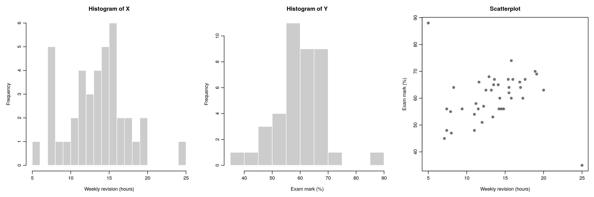
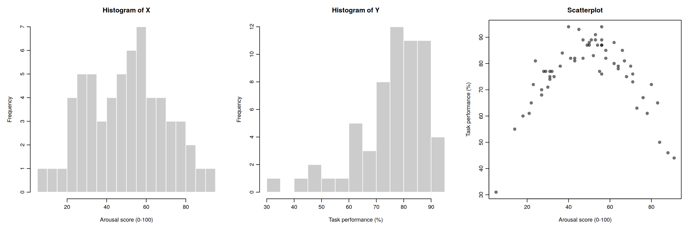
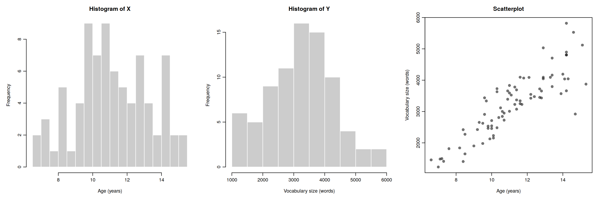
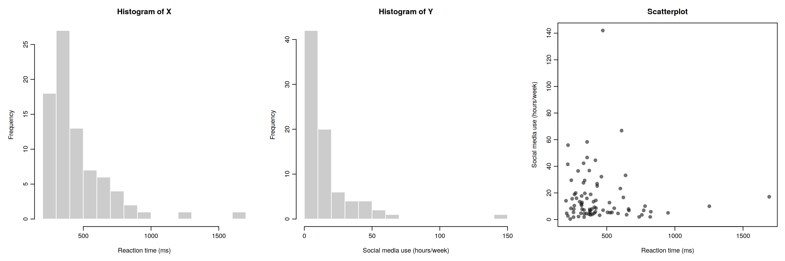
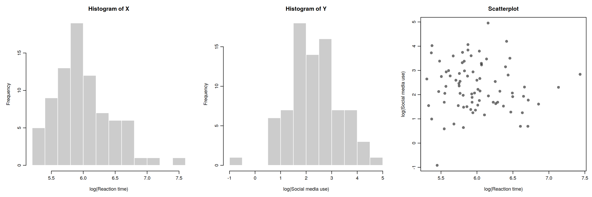

```{r}
#| eval: false
#| echo: false
#| warning: false
#| message: false
#| copy-code: true

```

::: {.callout-note title="Overview"}
This week we focus on two strands of learning:

A.  More on correlation analysis
B.  Research project: Refine research question, decide on measures, pre-register hypothesis

Building on last week’s work on how hypothesis testing and significance testing, **this week** we will continue to look at correlation as a measure of association between two numerical variables. We will review assumptions associated with Pearson's r, discuss some issues important to be aware of when interpreting correlation results and finally, we'll talk about intercorrelation.

We will also start the group project in which you will investigate the question: *Is mind wandering related to screen time?*

The materials we have prepared to support your learning are arranged in four parts:

-   Lectures
-   Reading
-   Pre-lab activities
-   Lab activities

You can navigate to each in the side bar on the right
:::

<!-- Note: I think it is helpful to have a list of the different sections in a week for cross-referencing. I don't think it helps readability it this is visible to the students (hence I've commented them out) as the outline in the sidebar on the right already provides this info. -->

<!-- - @sec-4141-w5-lectures: Watch these before your lab session -->

<!-- - @sec-4141-w5-lectures-theory:  -->

<!-- - @sec-4141-w5-lectures-report-correlation: Hypothesis testing and correlation -->

<!-- - @sec-4141-w5-lectures-project: An overview of the project -->

<!-- - @sec-4141-w5-reading: Recommended readings -->

<!-- - @sec-4141-w5-prelab-activities: Activities to do before you attend your lab session -->

<!-- - @sec-4141-w5-lab-activities: Activities you do during your lab session -->

## Lectures {#sec-4141-w5-lectures}

\newline

::: {.callout-important}
**Please watch the lecture material, complete the essential reading and then the pre-lab activities before attending your lab.** As a reminder, the lectures and pre-labs introduce the concepts and give you some initial practice, and the lab gives you the opportunity to apply these skills in-person with our support.
:::

::: {.callout-tip title="Questions?"}
Make a note of questions as you work through the material. These might be answered later in the recordings, or in your lab. Otherwise, please bring them to the live online Q&A session on Friday or post them on the [Q&A forum on Moodle](https://modules.lancaster.ac.uk/mod/forum/view.php?id=2918081).
:::

### Section A: More on correlation  {#sec-4141-w5-lectures-theory}

You can watch the lecture for the video using the video playback windows shown next. The lecture is split into different sections. You can download the slides for all sections together here: [More on correlation: slides](files/week5/4141_moreoncorrelation_slides.pdf){download="4141_moreoncorrelation_slides.pdf"}.

1.  **Theory -- Assumptions**(~35 minutes) 
Watch this part before you complete the reading and the pre-lab activities. The video has captions, in case you find that helpful. You can download the slides and a transcript from the links below the video.

```{=html}
<div style="position: relative; width: 100%; height: 0; padding-bottom: 56.25%">
	<iframe src="https://lancaster.cloud.panopto.eu/Panopto/Pages/Embed.aspx?id=b601d6f4-e545-43d3-a4a2-b4f6008fb65a&autoplay=false&offerviewer=true&showtitle=false&showbrand=false&captions=false&interactivity=all" style="border: 1px solid #464646; position: absolute; top: 0; left: 0; width: 100%; height: 100%; box-sizing: border-box;" allowfullscreen allow="autoplay" aria-label="Panopto Embedded Video Player" aria-description="4141_correlation_assumptions"></iframe>
</div>
```

\newline

[Assumptions: transcript](files/week5/4141_assumptions_transcript.txt){download="4141_assumptions_transcript.txt"}.

2.  **Theory -- What happens if assumptions are violated**(~20 minutes) 
You can download the slides and a transcript from the links below the video.

```{=html}
<div style="position: relative; width: 100%; height: 0; padding-bottom: 56.25%">
	<iframe src="https://lancaster.cloud.panopto.eu/Panopto/Pages/Embed.aspx?id=376c1da8-0ca7-4046-91b1-b4f6009d85ba&autoplay=false&offerviewer=true&showtitle=false&showbrand=false&captions=false&interactivity=all" style="border: 1px solid #464646; position: absolute; top: 0; left: 0; width: 100%; height: 100%; box-sizing: border-box;" allowfullscreen allow="autoplay" aria-label="Panopto Embedded Video Player" aria-description="4141_correlation_what_happens"></iframe>
</div>
```

\newline

[What happens when assumptions are violated: transcript](files/week5/4141_violations_transcript.txt){download="4141_violations_transcript.txt"}.

3.  **Theory -- Issues**(~35 minutes) 
You can download the slides and a transcript from the links below the video.

```{=html}
<div style="position: relative; width: 100%; height: 0; padding-bottom: 56.25%">
	<iframe src="https://lancaster.cloud.panopto.eu/Panopto/Pages/Embed.aspx?id=e45d8b83-5b6a-4ec0-b5ef-b4f600a5938e&autoplay=false&offerviewer=true&showtitle=false&showbrand=false&captions=false&interactivity=all" style="border: 1px solid #464646; position: absolute; top: 0; left: 0; width: 100%; height: 100%; box-sizing: border-box;" allowfullscreen allow="autoplay" aria-label="Panopto Embedded Video Player" aria-description="4141_correlation_issues"></iframe>
</div>
```

\newline

[Issues: transcript](files/week5/4141_issues_transcript.txt){download="4141_issues_transcript.txt"}.

<!-- **2. How to report a correlation analysis** (~ minutes) -->

<!-- How to apply the hypothesis testing framework to correlation and report the results of a correlation analysis following APA conventions. -->

<!-- [How to report correlation: slides](files/week4/4141_howto_reportcorrelation_slides.pdf){download="4141_howto_reportcorrelation_slides.pdf"}. -->

<!-- [How to report correlation: transcript](files/week4/4141_howto_reportcorrelation_transcript.txt){download="4141_4141_howto_reportcorrelation_transcript.txt"}. -->

<!-- ::: {.callout-note title="APA Style"} -->
<!-- APA stands for the American Psychological Association. APA style provides shared conventions and guidelines for how to write a research report in psychology. This includes how to report statistical results clearly and consistently. You can read about the APA style (7th edition) [here](https://apastyle.apa.org){target="_blank" rel="noopener"}. A useful summary on reporting numbers and statists in APA style can be found [here](files/week3/apa_report_stats.pdf){download="apa_numbers-statistics-guide.pdf"}). -->
<!-- ::: -->

::: {.callout-tip title="Take a break!"}
Before continuing, we recommend you take a **15-minute break away from your computer**. Remember to note down any questions to bring to the Q&A, lab or discussion forum whilst you’re watching the lectures.
:::

<!-- ### Section B: An overview of the project {#sec-4141-w4-lectures-project} -->

<!-- Section B has one part: -->

<!-- **1. The project: An overview** (~ minutes) -->

<!-- An overview of the project you will carry out and the research report you will write. -->

<!-- ```{=html} -->

<!-- ``` -->

<!-- \newline -->

<!-- [Project overview - slides](files/week4/4141_wk4_project_slides.pdf){download="4141_wk4_project_slides.pdf"}. -->

<!-- [Project overview - transcript](files/week4/4141_wk4_project_transcript.txt){download="4141_wk4_project_transcript.txt"}. -->

## Reading {#sec-4141-w5-reading}

::: {.callout-tip title="Easy access to readings"}
All reading is accessible via the library. You can go to Moodle -\> Library Resources -\> Resource List or you can follow [**this link**](https://lancaster.alma.exlibrisgroup.com/leganto/nui/lists/93496942590001221). Readings have one of the following tags:

-   **Essential**: We expect you to be familiar with these reading. You will be assessed on this.
-   **Recommended**: We highly recommend these readings. They often provide a different perspective, or explain things in a different way.
-   **Optional**: Further readings for those interested.

The reading list is divided into multiple sections:

-   **Reading associated with statistics**: this contains links to readings useful for the development of statistical concepts and skills. The main textbook *Fundamental statistics for the behavioral sciences* by Howell (Essential) lives here.
-   **Reading associated with psychological research principles and design**: this contains links to readings that provide a good basis for foundational knowledge around research design.
-   **Reading associated with Open Science principles and practices**: this contains links to key literature on the Open Science movement.
-   **Week by week**: these contain links to key reading for that week that are not listed on any of the more general lists above.
:::

For **week 5**, the reading is:

-   Howell, D. C. (2017). Fundamental statistics for the behavioral sciences (9th ed.). Cengage Learning. Chapter 9. **Essential** 
    - Focus on sections 9.5, 9.6, 9.7 and 9.12. These sections support the concepts introduced in the pre-recorded lecture on applying the hypothesis testing framework to correlation and reporting the results correctly.
    

## Pre-lab activities {#sec-4141-w5-prelab-activities}

### Pre-lab activity 1: Getting ready

To complete this week's lab activities you will need several files:

1.  We'll work with an example script called `4141_wk5_lab.qmd`. This is a Quarto document.
2.  We need several data files.

You can download the files here: [`4141_wk5_lab.zip`](files/week5/4141_wk5_lab.zip){download="4141_wk5_lab.zip"}. Usually they will be saved in your 'Downloads' folder.

Next, upload the zip-folder as it is to your Files space on the R-server (bottom right quadrant; no need to extract the files first).

Finally, open the example script by clicking on the file called `4141_wk5_lab.qmd` in the Files space on the R-server.

You are now ready to start work on the lab activities.

::: callout-important
## Watch the 'How to' videos

If you haven't done so already, this is a good time to watch the 'How to' videos on how to:

-   Use RStudio - [in this section](week1.qmd#sec-4141-w1-lectures-intro-how-r)
-   Build a plot - [in this section](week1.qmd#sec-4141-w1-lectures-intro-how-r)
-   Use `here()` - [in this section](week3.qmd#sec-4141-w3-lectures-correlation)
-   Use `mutate()` - [in this section](week3.qmd#sec-4141-w3-lectures-correlation)
-   Conduct and interpret correlation analysis - [in this section](week3.qmd#sec-4141-w3-lectures-correlation)
:::

## Lab activities {#sec-4141-w5-lab-activities}

<!-- ::: callout-tip -->
<!-- Information on the lab activities will follow soon. -->
<!-- ::: -->

### Lab activity 1: Assumptions of Correlation Analysis

#### Question 1: Types of variables

Correlation would be an appropriate form of analysis for researchers interested in the relationship between:

a.  Dog (breed) and height (cm) of owner
b.  Speed of swimming (mph) and area of tank (cm)
c.  Number of cows sitting and rain fall (mm)
d.  Total llama saliva (ml) expelled and gender of visitors
e.  b and d
f.  b and c

::: {.callout-tip}
For Pearson's *r*, we hope the data look like a smooth, oval cloud: a **straight-line** relationship, **equal spread** of Y at every value of X, and a bell shape. We also watch for **outliers**: participants who don't fit the overall pattern.

For each question below, look at the three plots (a histogram of X, a histogram of Y, and a scatterplot) and answer the questions. All the data are simulated for teaching.
:::

#### Question 2: Revision and exam marks

Forty students reported how many hours per week they spent revising and then sat an exam.

{fig-alt="Histogram of weekly revision hours, histogram of exam marks, and a scatterplot of exam mark against revision hours." width=100%}

a. Look at the two histograms only. Does any student look unusual? Note anything you see.
b. Now look at the scatterplot. Which students do not fit the overall pattern? Describe each one, giving their approximate revision hours and exam mark.
c. Why can the scatterplot reveal something the histograms cannot?
d. Before running any analysis, what should you check about these students? Give two possible explanations for their scores.
e. If you calculated Pearson's *r* for all 40 students, and then again without these students, would *r* get higher, lower or stay the same? Explain your reasoning.

#### Question 3: Arousal and task performance

Sixty participants completed a memory task. Before the task, each was given a score for how aroused (alert and activated) they felt.

{fig-alt="Histogram of arousal scores, histogram of task performance, and a scatterplot of performance against arousal." width=100%}

a. Describe the relationship between arousal and performance in words.
b. Look at the histograms. Do they suggest any problem with using Pearson's *r*?
c. Without calculating anything, would you expect Pearson's *r* to be strong and positive, strong and negative, or close to zero? Explain why.
d. Which assumption is violated here? Would switching to Spearman's rho solve the problem? Why or why not?
e. What does this example tell you about reporting a correlation coefficient without looking at the scatterplot?

#### Question 4: Age and vocabulary

Eighty children aged between 6 and 16 took a vocabulary test.

{fig-alt="Histogram of age, histogram of vocabulary size, and a scatterplot of vocabulary size against age." width=100%}

a. Compare the spread of vocabulary scores for children aged about 7 to 8 with those aged about 13 to 15. Give approximate ranges for each group.
b. Which assumption is violated? Name it and describe what is wrong in your own words.
c. Could you have spotted this problem from the two histograms alone? Explain.
d. Why might this problem affect the *p*-value for Pearson's *r*?
e. The spread of vocabulary scores grows roughly in proportion to the average score. Suggest one thing you could try.

#### Question 5: Reaction time and social media use

Eighty participants completed a reaction-time task and reported how many hours per week they spend on social media. Figure 4a shows the raw data.

{fig-alt="Histogram of reaction time, histogram of social media hours per week, and a scatterplot of social media hours against reaction time." width=100%}

a. Describe the shape of each histogram.
b. Does the scatterplot look like an oval, bell-shaped cloud? Which assumption(s) appear to be violated?
c. In the lecture simulations, what happened to the false-positive rate when variables were skewed but unrelated? What would you still want to check in the scatterplot?

Figure 4b shows the same data after taking the natural log of both variables.  Transforming the the data in this way is common approach for heavily skewed data.

{fig-alt="Histograms and a scatterplot of the same data after a log transformation." width=100%}

d. What has changed? Has the transformation solved every problem?
e. Give one advantage and one disadvantage of log-transforming the data.

### Lab activity 2: Finish lab activities from previous weeks (Recap - skip if completed successfully last week)

#### Background
Over the past few weeks, we worked with some publicly available data from a research project on mind wandering. You can have a look at the questionnaire [here](files/week1/BMW-3_eng.pdf).

If you did not successfully finish the lab activities for weeks 1, 2, 3, or 4 you may want to complete these first.

You can log into the R server, open your project (the `.Rproj` file) and open the Quarto file (ending with `.qmd`) to continue to work through these.

#### Aims of the activity
Ensure you are familiar with reading in a `.csv`-file, creating a histogram and calculating summary statistics.

#### Steps

1. Login to the R-server
2. Click on the R-project (the `Rproj`) file to open it
3. In the Files tab (right bottom quadrant), navigate to the example script for that week's lab activities. This is the Quarto file (ending with `.qmd`). Click on it to open it.
4. Complete any remaining activities

### Lab activity 3: Checking for missing data

#### Aims of the activity
We are going to:

1.  Setup the appropriate bits and pieces in RStudio
2.  Read in the data files
3.  Check for missing data
4.  Calculate and interpret Pearson's r using `correlation()`

<!-- ::: callout-tip -->
<!-- Information on this lab activity will follow soon. -->
<!-- ::: -->

#### Step 1: Setup the appropriate bits and pieces in RStudio

Before we can do anything, we need tell R what packages we want to use. We use the function `library()` to do that. It is useful to have a section at the top of your script where you load all the relevant libraries.

> Action: Insert a new code chunk by clicking on 'Code' at the top and selecting 'Insert Chunk'.In the code chunk, write code to load the libraries by using the `library()` function. We need the packages `here`, `tidyverse` and `easystats`. After you've written the code, make sure the run the code chunk (click on the green arrow in the top corner of the code chunk).

::: {.callout-note title="Hint" collapse="true"}
We need to load several packages (`here`, `tidyverse` and `easystats`) using the `library()` function. First, inside the code chunk, write `library()` and put `here` inside the brackets. On the next line in the code chunk, write `library()` and put `tidyverse` inside the brackets. On a third line in the code chunk, write `library()` and put `easystats` inside the brackets. Make sure to run the code chunk by clicking on the green arrow in the top corner of the code chunk.
:::

#### Step 2: Read in the data

For this lab activity, you'll need the file named `vocabulary_experience.csv`.

> Action: Insert a new code chunk by clicking on 'Code' at the top and selecting 'Insert Chunk'. Inside the chunk, use `read_csv()` to read in the data file named `vocabulary_experience.csv`; tell R where to find the file and what it is called. Make sure you've run the code chunk. Then, check that you can see the 'object' (also called 'data-frame') in the Environment (top right quadrant) for the file you read in. I've called the data-frame `data_thirty`. If you can't remember how to do this, look at the Hint below. Give it a go. If you are still stuck, look at the Code below. You may have to adapt the filepath to match your setup.

::: {.callout-note title="Hint" collapse="true"}
`dataframe <- read_csv(here("filepath to folder", "filename.extension))`

Your code should include:

- dataframe: the name of the object you want to save the data in (such as `data_thirty`) 
- <- : assignment arrow
- read_csv() : the `read_csv()` function
- here(): the `here()` function
- "filepath to folder": the folders that you need to point R to starting from whereever *here* starts
- "filename.extension": the name of the datafile, including the extension
:::

::: {.callout-note title="Code" collapse="true"}
```r
data_thirty <- read_csv(here("4141_wk5_lab", "vocabulary_experience.csv"))
```
:::

**Questions Step 2**

a. How many participants does the data frame contain?
b. How many degrees of freedom would you expect to see in the output if you were to run a correlation analysis with the variables `vocabulary` and `experience` using this data frame?

#### Step 3: Check for missing data

We can check whether there are any missing data in a data-frame in multiple ways:

1. We can click on the data frame in the Environment (upper right quadrant). The data frame will then open in the Source quadrant (upper left quadrant). Any 'empty' cells will have an `NA` (which stands for 'Not available') in them.
2. We can use the `glimpse()` function. This gives a compact overview of the data frame, showing the number of rows and columns, then each variable's name, its type (such as `<dbl>` for numbers or `<chr>` for text) and its first few values, so you can quickly check that the data have been read in correctly. Missing data are shown as [NA]{style="color: red"}.
3. We can use some code to check how many missing data points a data frame contains. For this we use the `is.na()` function inside the `sum()` function.
4. We can use some code to check how many participants have complete data. For this we use the `complete.cases()` function inside the `sum()` function.

> Actions:
1. Click on the data frame in the Environment and have a look at it in the Source quadrant.
2. Use the `glimpse()` function to have a look at the data frame.
3. Use the `is.na()` function in combination with the `sum()` function to check how many NAs there are.
4. Use the `complete.cases()` function in combination with the `sum()` function to check how many participants have complete data.
You can use the code below to do this. Have a look at each line of code and make sure you understand what the different bits are doing.

```r
# Have a look at the data frame
glimpse(data_thirty) 

# Check the number of NAs in the data frame
check_n_NA <- sum(is.na(data_thirty))                 
check_n_NA

# Check the number of participants with complete data
check_n_complete <- sum(complete.cases(data_thirty))
check_n_complete
```

> Action: Run a correlation analysis with these data. If you can't remember how to do this, look at the Hint below. Give it a go. If you are still stuck, look at the Code below.

::: {.callout-note title="Hint" icon="false" collapse="true"}
Use the `correlation`() function we used last week. You need to specify the following information inside the `correlation`() function:

- data: data = `data_thirty`
- variables: select = c("vocabulary", "experience")
- method = "pearson"
- p_adjust = "none"
:::

::: {.callout-note title="Code" icon="false" collapse="true"}
```r
results <- correlation(data = data_thirty,          # use the `correlation()` function and tell R what data to use
            select = c("vocabulary", "experience"), # specify the variables we want to correlate using `select()`
            method = "pearson",                     # specify which method to use; `"pearson"` is the default
            p_adjust = "none")                      # we'll come back to this in a couple of weeks
results
```
:::

**Questions Step 3**

a. How many data points are missing?
b. How many participants have complete data?
c. How many degrees of freedom are reported in the output from the correlation analysis. Explain how that number is derived. Does it match what you expected to see based on the number of participants?

### Lab activity 4: Outliers

#### Aims of the activity

We are going to:

1.  Read in the data file
2.  Build scatterplots with `geom_point()`, and add a line of best fit using `geom_smooth()`
3.  Remove outliers using `filter()`, and create another scatterplot
4.  Calculate and interpret Pearson's r using `correlation()` for data with and without outlier values

#### Step 1:  Read in the data file

For this lab activity, you'll need the file named `revision_exam.csv`.

> Action: Insert a new code chunk and use `read_csv()` to read in the data file named `revision_exam.csv`; tell R where to find the file and what it is called. Make sure you've run the code chunk. Then, check that you can see the 'object' (also called 'data-frame') in the Environment (top right quadrant) for the file you read in.

#### Step 2: Build a scatterplot

Now we are ready to build a scatterplot to visualise the relationship between two of the variables. We are going to look at the relationship between revision time and exam marks.

> Action: Insert a new code chunk and use `ggplot()` to tell R what data to plot and which variables tot use. Then, add layers to plot the datapoints (use `geom_point()`) and the line of best fit (use `geom_smooth(method="lm", se=TRUE)`). If you need more guidance on how to do this, look at the Hint below. If you are still stuck, you can look at the Code below.

::: {.callout-note title="Hint" icon="false" collapse="true"}
Use the function `ggplot()`. Start by writing `ggplot()` on the next line of the code chunk. Inside the `ggplot()` function, we need to tell R which data-frame (`data=`) and which variables to use (`mapping=aes(x= , y= ))`).

Then, we need to tell R what type of plot we want. We do this by adding a `+` to the line on which you've written `ggplot()`, then on the next line you add a 'geometric object', in this case `geom_point()`.

We also want to add a line of best fit. We do this by adding a `+` to the line on which you've written `geom_point()`, then on the next line you add another 'geometric object', in this case `geom_smooth()`. We want to specify what type of line of best fit, we do this by adding `method="lm", se=TRUE` inside the brackets of `geom_smooth()`.

This will give you a basic scatterplot. Revisit the lab activity code from week 1 to remind yourself how to change any of the features (such as the colour, the background, add titles to the axes etc.).
:::

::: {.callout-note title="Code" icon="false" collapse="true"}
```r
ggplot(data = data_revision_exam, mapping = aes(x=revision_hours, y=exam_mark)) +
  geom_point() +
  geom_smooth(method = "lm", se=TRUE)
```
:::

#### Step 3: Remove outliers using `filter()`, and create another scatterplot
Now,we'll remove the two participants with outlier values. We'll do this using the `filter()` function from the `dplyr` package (part of the `tidyverse`).

::: {.callout-tip title="How does `filter()` work?"}
The `filter()` function allows you to select specific rows from a data frame based on one or more conditions.

For example, imagine we have a dataset containing information about participants in a psychology study, including their age and gender. We might want to select only participants who are over 18 years old.

We can do this using:

```r
filter(data, age > 18)
```

Here:
- `data` is the name of our data frame.
- `age > 18` is the condition we want to apply.
- note these two bits of information are separated within the function by a comma.
- only rows where the condition is `TRUE` are kept.

We can also apply multiple conditions. For example, to select participants who are over 18 **and** identify as a woman:

```r
filter(data, age > 18, gender == "Woman")
```

When we provide multiple conditions separated by commas, `filter()` keeps only rows that satisfy **all** of the conditions.

Some useful operators for filtering data include:

| Operator | Meaning | Example |
|---|---|---|
| `==` | Equal to | `gender == "Woman"` |
| `!=` | Not equal to | `gender != "Woman"` |
| `>` | Greater than | `age > 18` |
| `<` | Less than | `age < 30` |
| `>=` | Greater than or equal to | `age >= 18` |
| `<=` | Less than or equal to | `age <= 30` |

We can also use `&` (AND) and `|` (OR) to combine conditions.

For example:

```r
filter(data, age >= 18 & age <= 30)
```

This selects participants aged between 18 and 30 (inclusive).
:::

> Action: Use `filter()` to remove the two participants with outlier values. We can do this by specifying that we only want to keep data from participants who revised for more than 5, but less than 25 hours. The code on the handbook page does this. You can copy the code into your script. Please have a close look and, using the information above, make sure you understand what each part of the code does.

```r
data_revision_exam_clean <- filter(data_revision_exam, revision_hours >5 & revision_hours < 25 )
```

> Action: Now let make a scatterplot without the two participants with outlier values. As before, insert a new code chunk and use `ggplot()` to tell R what data to plot and which variables tot use. Make sure to use `data_revison_exam_clean`. Then, add layers to plot the datapoints (use `geom_point()`) and the line of best fit (use `geom_smooth(method="lm", se=TRUE)`).


**Questions Step 3**

a. Looking at the line of best fit in the first scatterplot (which included the participants with outlier values), how would you describe the relationship between revision hours and exam mark?
b. What do you estimate the value of the correlation coefficient to be?
c. Looking at the line of best fit in the second scatterplot (without the participants with outlier values), how would you describe the relationship between revision hours and exam mark now?
d. What do you estimate the value of the correlation coefficient to be now?

#### Step 4: Calculate and interpret Pearson's r using `correlation()` for data with and without outlier values

> Action: Run two correlation analyses: one with the data with (`data_revision_exam`) and one with the data without (`data_revision_exam_clean`) outlier values. If you can't remember how to do this, look at the Hint below. Give it a go. If you are still stuck, look at the code you wrote for Lab activity 3, Step 3.

::: {.callout-note title="Hint" icon="false" collapse="true"}
Use the `correlation`() function we used last week. You need to specify the following information inside the `correlation`() function:

- data: data = `data_revision_exam`
- variables: select = c("revision_hours", "exam_mark")
- method = "pearson"
- p_adjust = "none"
:::

### Lab activity 5: Spearman's *rho*

#### Aims of the activity

We are going to:

1.  Read in the data file
2.  Build a scatterplot with `geom_point()`, and add a line of best fit using `geom_smooth()`
4.  Calculate and interpret Pearson's *r* and Spearman's *rho* using `correlation()`

#### Step 1:  Read in the data file

For this lab activity, you'll need the file named `reading_enjoyment_books.csv`. It contains data from sixty adults who were asked how much they enjoy reading (variable name = `reading_enjoyment`), on a single item from 1 (not at all) to 5 (very much), and how many books they had read in the past 12 months (variable name = `books_read`).

> Action: Insert a new code chunk and use `read_csv()` to read in the data file named `reading_enjoyment_books.csv`; tell R where to find the file and what it is called. Make sure you've run the code chunk. Then, check that you can see the 'object' (also called 'data-frame') in the Environment (top right quadrant) for the file you read in.

#### Step 2: Build a scatterplot using `geom_jitter()` instead of `geom_point()`

Now we are ready to build a scatterplot to visualise the relationship between reading enjoyment and number of books read.

> Action: Insert a new code chunk and use `ggplot()` to tell R what data to plot and which variables tot use. Then, add layers to plot the datapoints (use `geom_point()`) and the line of best fit (use `geom_smooth(method="lm", se=TRUE)`). If you need more guidance on how to do this, look at the Hint below. If you are still stuck, you can look at the code you wrote for Lab activity 4, Step 2.

::: {.callout-note title="Hint" icon="false" collapse="true"}
Use the function `ggplot()`. Start by writing `ggplot()` on the next line of the code chunk. Inside the `ggplot()` function, we need to tell R which data-frame (`data=`) and which variables to use (`mapping=aes(x= , y= ))`).

Then, we need to tell R what type of plot we want. We do this by adding a `+` to the line on which you've written `ggplot()`, then on the next line you add a 'geometric object', in this case `geom_point()`.

We also want to add a line of best fit. We do this by adding a `+` to the line on which you've written `geom_point()`, then on the next line you add another 'geometric object', in this case `geom_smooth()`. We want to specify what type of line of best fit, we do this by adding `method="lm", se=TRUE` inside the brackets of `geom_smooth()`.

This will give you a basic scatterplot. Revisit the lab activity code from week 1 to remind yourself how to change any of the features (such as the colour, the background, add titles to the axes etc.).
:::

Many of the participants gave the same rating and read the same number of books, so their points sit exactly on top of each other. `geom_jitter()` fixes this by moving each point a tiny random amount, so overlapping points spread out and you can see how many there are.

::: {.callout-tip title="How does `geom_jitter()` work?"}
`geom_jitter()` moves each point a tiny random amount, so overlapping points spread out and you can see how many there are.

You can tell R how to jitter the data points:

- `width` = 0.1 is the largest random nudge to the left or right. Ratings are whole numbers, so a point at 3 is moved to somewhere between 2.9 and 3.1. This is small enough that the five vertical stripes stay clearly separate.
- `height` = 0 means the points are not moved up or down. The number of books is a real count, so nudging points vertically would make the plot show values that aren’t in the data.
- `alpha` = 0.6 makes the points partly transparent (0 is invisible and 1 is solid). Where points overlap, the colour becomes darker, which gives a second clue about where the data are concentrated.

Jittering only changes how the plot looks. The data and the correlation are not affected.
:::

> Action: Instead of using `geom_point()` in the scatterplot, try `geom_jitter(width = 0.1, height = 0, alpha = 0.6)`.


#### Step 3: Calculate and interpret Pearson's *r* and Spearman's *rho* using `correlation()`

> Action: Run two correlation analyses: one with Pearson's *r*, the other one with Spearman's *rho*. If you can't remember how to do this, look at the Hint below. Give it a go. If you are still stuck, look at the code you wrote for Lab activity 3, Step 3. When calculating Spearman's *rho*, specify "spearman" under method instead of "pearson".

::: {.callout-note title="Hint" icon="false" collapse="true"}
Use the `correlation`() function we used last week. You need to specify the following information inside the `correlation`() function:

- data: data = `data_revision_exam`
- variables: select = c("revision_hours", "exam_mark")
- method = "pearson" or "spearman"
- p_adjust = "none"
:::

**Questions Step 3**

a. What is the value for Pearson's *r*, is it significant?
b. What is the value for Spearman's *rho*, is it significant?
c. What is the correct correlation coefficient to use. Explain why.

## Answers

::: callout-tip
Answers to the questions in lab activities will be shared after the final lab session of the week has concluded (Thursday afternoon)
:::

<!-- ### Lab activity 1: Assumptions of Correlation Analysis -->

<!-- #### Question 1: Types of variables -->

<!-- Correlation would be an appropriate form of analysis for researchers interested in the relationship between: -->

<!-- a.  Dog (breed) and height (cm) of owner -->
<!-- b.  Speed of swimming (mph) and area of tank (cm) -->
<!-- c.  Number of cows sitting and rain fall (mm) -->
<!-- d.  Total llama saliva (ml) expelled and gender of visitors -->
<!-- e.  b and d -->
<!-- f.  b and c -->

<!-- ::: {.callout-note icon=false title="Question 1: Answer" collapse="true"} -->
<!-- a.  Dog (breed) and height (cm) of owner -->
<!-- b.  Speed of swimming (mph) and area of tank (cm) -->
<!-- c.  Number of cows sitting and rain fall (mm) -->
<!-- d.  Total llama saliva (ml) expelled and gender of visitors -->
<!-- e.  b and d -->

<!-- **f. b and c** **All variables in b anc c are continuous. Dog breed and gender are categorical.** -->
<!-- ::: -->

<!-- #### Question 2: Revision and exam marks -->

<!-- Forty students reported how many hours per week they spent revising and then sat an exam. -->

<!-- {fig-alt="Histogram of weekly revision hours, histogram of exam marks, and a scatterplot of exam mark against revision hours." width=100%} -->

<!-- a. Look at the two histograms only. Does any student look unusual? Note anything you see. -->
<!-- b. Now look at the scatterplot. Which students do not fit the overall pattern? Describe each one, giving their approximate revision hours and exam mark. -->
<!-- c. Why can the scatterplot reveal something the histograms cannot? -->
<!-- d. Before running any analysis, what should you check about these students? Give two possible explanations for their scores. -->
<!-- e. If you calculated Pearson's *r* for all 40 students, and then again without these students, would *r* get higher, lower or stay the same? Explain your reasoning. -->

<!-- ::: {.callout-note title="Question 2: Answer" icon=false collapse="true"} -->
<!-- **a.** Nothing clearly wrong. There are isolated bars at the ends of both histograms (about 5 and 25 hours; about 35 and 88 per cent), but each value is plausible on its own and nothing says that those bars belong to the same students. -->

<!-- **b.** Two students. -->

<!-- - **Participant 7:** about 5 hours of revision but a mark of about 88%, much higher than the pattern predicts. -->
<!-- - **Participant 23:** about 25 hours of revision but a mark of about 35%, much lower than the pattern predicts. -->

<!-- Both go against the positive trend shown by the other students. -->

<!-- **c.** The histograms show each variable on its own, and both students have values that are unusual but not impossible for each variable. They are only unusual in combination, which can only be seen when the two variables are plotted together. -->

<!-- **d.** Check for data-entry errors, such as typos, swapped or mismatched IDs, and misread marks. Other possibilities are a genuine but atypical participant (for example, prior knowledge from an earlier course, illness on the exam day, or a resit student) and a misunderstanding of the question about revision. The key message is to investigate and document, and not to delete cases just because they make the result awkward. -->

<!-- **e.** *r* would get higher. It looks like there may be a strong positive relationship without participants 7 and 23. I'd estimate *r* to be between .55 and .70. With the two students included, *r* is likely to be smaller as their datapoints go against the pattern of the rest of the sample. -->

<!-- *Link to the lecture:* in the simulation, a few participants who were extreme on both measures made about 20% of samples significant when there was no real relationship. Here the same kind of case has the opposite effect, masking a real relationship. -->
<!-- ::: -->

<!-- #### Question 3: Arousal and task performance -->

<!-- Sixty participants completed a memory task. Before the task, each was given a score for how aroused (alert and activated) they felt. -->

<!-- {fig-alt="Histogram of arousal scores, histogram of task performance, and a scatterplot of performance against arousal." width=100%} -->

<!-- a. Describe the relationship between arousal and performance in words. -->
<!-- b. Look at the histograms. Do they suggest any problem with using Pearson's *r*? -->
<!-- c. Without calculating anything, would you expect Pearson's *r* to be strong and positive, strong and negative, or close to zero? Explain why. -->
<!-- d. Which assumption is violated here? Would switching to Spearman's rho solve the problem? Why or why not? -->
<!-- e. What does this example tell you about reporting a correlation coefficient without looking at the scatterplot? -->

<!-- ::: {.callout-note title="Question 3: Answer" icon=false collapse="true"} -->
<!-- **a.** An inverted U. Performance is lowest at very low and very high arousal, and highest at moderate arousal (around 40 to 60). -->

<!-- **b.** Not really. The arousal histogram is roughly symmetrical, and the performance histogram has a slight tail towards low scores. Neither shows the curve. -->

<!-- **c.** Close to zero. The positive trend on the left of the plot cancels out the negative trend on the right. -->

<!-- **d.** **Linearity.** Spearman's rho will not help, because the relationship is not monotonic: it rises and then falls. -->

<!-- **e.** A coefficient alone can hide a strong relationship. Always plot the data first. A correlation near zero means "no linear relationship", not "no relationship". -->
<!-- ::: -->

<!-- #### Question 4: Age and vocabulary -->

<!-- Eighty children aged between 6 and 16 took a vocabulary test. -->

<!-- {fig-alt="Histogram of age, histogram of vocabulary size, and a scatterplot of vocabulary size against age." width=100%} -->

<!-- a. Compare the spread of vocabulary scores for children aged about 7 to 8 with those aged about 13 to 15. Give approximate ranges for each group. -->
<!-- b. Which assumption is violated? Name it and describe what is wrong in your own words. -->
<!-- c. Could you have spotted this problem from the two histograms alone? Explain. -->
<!-- d. Why might this problem affect the *p*-value for Pearson's *r*? -->
<!-- e. The spread of vocabulary scores grows roughly in proportion to the average score. Suggest one thing you could try. -->

<!-- ::: {.callout-note title="Question 4: Answer" icon=false collapse="true"} -->
<!-- **a.** Around 7 to 8 years, scores are roughly 1,200 to 2,000 words (a range of about 800). Around 13 to 15 years, they are roughly 2,900 to 5,800 (a range of nearly 3,000). The spread is clearly larger for older children. -->

<!-- **b.** **Homoscedasticity** (equal spread). The spread of Y is not constant across X: the scatter fans out as age increases. -->

<!-- **c.** No. Both histograms look reasonably bell-shaped, and nothing about them suggests a problem. The unequal spread is a feature of the *relationship*, which only the scatterplot shows. -->

<!-- **d.** Because Pearson's *r* assumes the spread is similar at every value of X. When it isn't, the *p*-value can be inaccurate. In the lecture simulation, funnel-shaped data produced about twice as many false positives as expected when there was no real relationship. -->

<!-- **e.** Spearman's rho is an option, but it only partly helps with unequal spread. Analysing age groups separately is a possibility. There are other options you'll learn about later (using regression or log-transforming the data). -->
<!-- ::: -->

<!-- #### Question 5: Reaction time and social media use -->

<!-- Eighty participants completed a reaction-time task and reported how many hours per week they spend on social media. Figure 4a shows the raw data. -->

<!-- {fig-alt="Histogram of reaction time, histogram of social media hours per week, and a scatterplot of social media hours against reaction time." width=100%} -->

<!-- a. Describe the shape of each histogram. -->
<!-- b. Does the scatterplot look like an oval, bell-shaped cloud? Which assumption(s) appear to be violated? -->
<!-- c. In the lecture simulations, what happened to the false-positive rate when variables were skewed but unrelated? What would you still want to check in the scatterplot? -->

<!-- Figure 4b shows the same data after taking the natural log of both variables. Transforming the the data in this way is common approach for heavily skewed data. -->

<!-- {fig-alt="Histograms and a scatterplot of the same data after a log transformation." width=100%} -->

<!-- d. What has changed? Has the transformation solved every problem? -->
<!-- e. Give one advantage and one disadvantage of log-transforming the data. -->

<!-- ::: {.callout-note title="Question 5: Answer icon=false collapse="true"} -->
<!-- **a.** Both are strongly right-skewed. Reaction time peaks around 300 to 400 ms with a long tail to about 1,700 ms. Social media use peaks at under 10 hours per week with a long tail to about 140 hours. -->

<!-- **b.** No. Most points are crowded at the lower left, with a few extreme points scattered to the right and above. The main problem is **non-normality** of both variables (skew), and the few extreme points could have a large influence on *r*. -->

<!-- **c.** When skewed variables were independent, the false-positive rate stayed at about 5%, so the test was robust to skew. However, you should still check the scatterplot for extreme points that might have a large influence, and for any curvature. -->

<!-- **d.** Both histograms are more symmetrical, and the scatterplot is a more evenly spread cloud, with no extreme points dominating. It isn't perfect: reaction time is still slightly right-skewed after the log transform. -->

<!-- **e.** *Advantage:* it keeps all the information in the data, and often makes proportional relationships linear and spreads even. It is also common for variables like reaction times. *Disadvantage:* results are on a log scale, so they are harder to interpret and to explain, and it can't be used for zero or negative values without adjustment. -->
<!-- ::: -->

<!-- ### Lab activity 3: -->

<!-- **Questions Step 2** -->
<!-- a. How many participants does the data frame `data_thirty` contain? -->
<!-- b. How many degrees of freedom would you expect to see in the output if you were to run a correlation analysis with the variables `vocabulary` and `experience` using the `data_thirty` data frame? -->

<!-- ::: {.callout-note title="Questions Step 3: Answers icon="false" collapse="true"} -->
<!-- a. The `data_thirty` data frame contains data from 30 participants. We can see this from the number of rows (or obs.) it has. -->
<!-- b. The degrees of freedom for a correlation analysis are determined by the sample size (N) minus 2. If all participants had complete data, we would expect the degrees of freedom to be 30-2 = 28. -->
<!-- ::: -->

<!-- **Questions Step 3** -->
<!-- a. How many data points are missing? -->
<!-- b. How many participants have complete data? -->
<!-- c. How many degrees of freedom are reported in the output from the correlation analysis. Explain how that number is derived. Does it match what you expected to see based on the number of participants? -->

<!-- ::: {.callout-note title="Questions Step 4: Answers" icon="false" collapse="true"} -->
<!-- a. There are 6 missing data points. -->
<!-- b. The data frame contains 25 participants who have complete data. -->
<!-- c. The degrees of freedom reported in the output from the correlation analysis is 23. Because only 25 participants have complete data and correlation analysis requires participants to contribute a data point on each variable, the other participants are dropped from the analysis. This leaves us with N=25-2 = 23 degrees of freedom. -->
<!-- ::: -->

<!-- ### Lab activity 4: -->

<!-- **Questions Step 3** -->
<!-- a. Looking at the line of best fit in the first scatterplot (which included the participants with outlier values), how would you describe the relationship between revision hours and exam mark? -->
<!-- b. What do you estimate the value of the correlation coefficient to be? -->
<!-- c. Looking at the line of best fit in the second scatterplot (without the participants with outlier values), how would you describe the relationship between revision hours and exam mark now? -->
<!-- d. What do you estimate the value of the correlation coefficient to be now? -->

<!-- ::: {.callout-note title="Questions Step 3: Answers" icon="false" collapse="true"} -->
<!-- a. The line of best fit is a horizontal line, suggesting there is no relationship between revision hours and exam mark. -->
<!-- b. The correlation coefficient is likely around 0. -->
<!-- c. The line of best fit suggest a positive relationship between revision hours and exam mark. People who spent more hours revising, performed better in the exam. -->
<!-- d. As the datapoints are relatively close to the line, the correlation coefficient is likely to between .60 and .70. -->
<!-- ::: -->

<!-- **Questions Step 4** -->
<!-- a. What is *r* for the relationship between revision hours and exam mark when using the data that includes participants with outlier values? Is it significant? -->
<!-- b. What is *r* for the relationship between revision hours and exam mark when using the data that does not include participants with outlier values? Is it significant? -->

<!-- ::: {.callout-note title="Questions Step 4: Answers" icon="false" collapse="true"} -->
<!-- a. Using the full data set we found no significant correlation between weekly revision hours and exam marks, *r*(38) = .05, *p* = .757. -->
<!-- b. After removing two participants, there was a strong positive correlation between weekly revision hours and exam marks, *r*(36) = .67, *p* < .001. People who revised for more hours, scored higher on the exam. -->
<!-- ::: -->

<!-- ### Lab activity 5: -->

<!-- **Questions Step 3** -->
<!-- a. What is the value for Pearson's *r*, is it significant? -->
<!-- b. What is the value for Spearman's *rho*, is it significant? -->
<!-- c. What is the correct correlation coefficient to use. Explain why. -->

<!-- ::: {.callout-note title="Questions Step 3: Answers" icon="false" collapse="true"} -->
<!-- a. Pearson: *r*(58) = .23, *p* = .079, which is not significant. -->
<!-- b. Spearman: *rho*(58) = .60, p < .001, which is significant. -->
<!-- c. The main reason is that one variable (`reading_enjoyment`) is ordinal. A single rating item has ordered categories, but nobody can say that the step from 1 to 2 equals the step from 4 to 5. Pearson’s *r* assumes equal intervals. In the scatterplot, the points fall in five vertical stripes instead of a cloud, which is a sign of ordinal data. -->
<!-- Additionally, the other variable (`books_read`) is a skewed count. Most people read a handful of books, but two heavy readers (48 and 56 books) are far from everyone else. Those two sit at middling enjoyment ratings, so they pull a straight line away from the real trend. Because Spearman's *rho* is based on ranks, it is less affected by those values and the overall trend is captured more accurately. -->
<!-- ::: -->