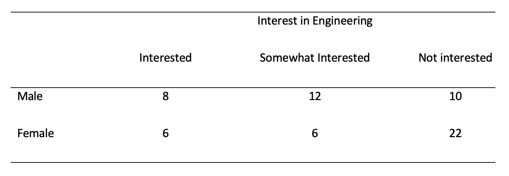

```{r}
#| eval: false
#| echo: false
#| warning: false
#| message: false
#| copy-code: true

```

::: {.callout-note title="Overview"}
This week we focus on two strands of learning:

A.  Chi-square as a measure of association between categorical variables
B.  Research project: Refine research question, decide on measures, pre-register hypothesis

So far, we've looked at measures of association between variables at the ordinal, interval or ratio level ((Spearman'ss *rho* or Pearson's *r*). **This week** you will learn about a measure that can be used to measure an association between categorical variables.

We will also start the group project in which you will investigate the question: *Is mind wandering related to screen time?*

The materials we have prepared to support your learning are arranged in four parts:

-   Lectures
-   Reading
-   Pre-lab activities
-   Lab activities

You can navigate to each in the side bar on the right
:::

<!-- Note: I think it is helpful to have a list of the different sections in a week for cross-referencing. I don't think it helps readability it this is visible to the students (hence I've commented them out) as the outline in the sidebar on the right already provides this info. -->

<!-- - @sec-4141-w6-lectures: Watch these before your lab session -->

<!-- - @sec-4141-w6-reading: Recommended readings -->

<!-- - @sec-4141-w6-prelab-activities: Activities to do before you attend your lab session -->

<!-- - @sec-4141-w6-lab-activities: Activities you do during your lab session -->

## Lectures {#sec-4141-w6-lectures}

**A. Theory - Associations between categorical variables** (~23 min)
Watch this part before you complete the reading and the pre-lab activities. The video has captions, in case you find that helpful. You can download the slides and a transcript from the links below the video.

```{=html}
<div style="position: relative; width: 100%; height: 0; padding-bottom: 56.25%">
	<iframe src="https://lancaster.cloud.panopto.eu/Panopto/Pages/Embed.aspx?id=36924c93-5387-4619-b221-b4fa013e8d31&autoplay=false&offerviewer=true&showtitle=false&showbrand=false&captions=true&interactivity=all" style="border: 1px solid #464646; position: absolute; top: 0; left: 0; width: 100%; height: 100%; box-sizing: border-box;" allowfullscreen allow="autoplay" aria-label="Panopto Embedded Video Player" aria-description="statschisquaretheory"></iframe>
</div>
```
[Associations between categorical variables - slides](files/week6/4141_chisquare_slides.pdf)
[Associations between categorical variables - transcript](files/week6/4141_chisquare_transcript.txt)

**B. The mini research project** (~9 minutes)
If you haven't already, make sure you watch the overview video on the mini research project on the project page [here](project.qmd#sec-4141-project-overview).

## Reading {#sec-4141-w6-reading}

::: {.callout-tip title="Easy access to readings"}
All reading is accessible via the library. You can go to Moodle -\> Library Resources -\> Resource List or you can follow [**this link**](https://lancaster.alma.exlibrisgroup.com/leganto/nui/lists/93496942590001221). Readings have one of the following tags:

-   **Essential**: We expect you to be familiar with these reading. You will be assessed on this.
-   **Recommended**: We highly recommend these readings. They often provide a different perspective, or explain things in a different way.
-   **Optional**: Further readings for those interested.

The reading list is divided into multiple sections:

-   **Reading associated with statistics**: this contains links to readings useful for the development of statistical concepts and skills. The main textbook *Fundamental statistics for the behavioral sciences* by Howell (Essential) lives here.
-   **Reading associated with psychological research principles and design**: this contains links to readings that provide a good basis for foundational knowledge around research design.
-   **Reading associated with Open Science principles and practices**: this contains links to key literature on the Open Science movement.
-   **Week by week**: these contain links to key reading for that week that are not listed on any of the more general lists above.
:::

For **week 6**, the reading is:

-   Howell, D. C. (2017). Fundamental statistics for the behavioral sciences (9th ed.). Cengage Learning. Chapter 19. **Essential** 

- Key readings for the mini research project as outlined [here](project.qmd#sec-4141-project-reading).
   
:::{.callout-tip}
Please note that I might mention an alternative textbook in the lectures. The content is highly similar, but this year, we've decided to use Howell (2017) as the core text. So no need to look at the book by Greene & D'Oliveira (2006).
:::

## Pre-lab activities {#sec-4141-w6-prelab-activities}

After having watched the lectures and read the textbook chapter you'll be in a good position to try these activities. Completing them before you attend your lab session will help you to consolidate your learning and help move through the lab activities more smoothly.

### Pre-lab activity 1: Refine the research question.

Each group will investigate the following question: *Is mind wandering related to screen time?*
Each group will refine this research question and decide:

- What aspect of mind wandering to focus on and how to measure it
- What aspect of screen time to focus on and how to measure it

Please read the key readings  ([more info on the project page here](project.qmd#sec-4141-project-reading)) before the lab session. In your group, you will discuss your ideas about mind wandering and screen time, how to refine the research question, and how to measure each construct.

### Pre-lab activity 2: Calculating Chi-square by hand and interpreting the results

Is there a relationship between the number of people who smoke and the number of people who drink? Please note that the question is the number of people (frequency) and not how much people drink/smoke. Also note that these are fictitious data. You'll need a table of critical values for Chi-square. This can be found [**here**](files/week6/4141_chisquare_cheatsheet_and_table.pdf), and also in the zip-folder you'll be asked to download in the a later pre-lab activity.

 

Pre-lab activity questions:

1.  Complete the Pearson's Chi-square test by hand using the data above and fill in the blanks:

$\chi 2$ ( , *N* = ) = , *p*

2.  Can you reject the null hypothesis?

### Pre-lab activity 3: Data visualisation - Creating a bar chart
We've been using the `ggplot2` package for visualising data. You can read a great overview of the `ggplot2` package [here](https://ggplot2.tidyverse.org). It also links to a 'cheatsheet' that you can download as a .pdf document. Lots of useful info on there!

With regard to visualising relations between categorical variables, the `geom_bar()` function is important. The following 'recipe' summarises what it does and how to use it.

\newline
`geom_bar()` - create a bar chart - [**recipe**](https://posit.cloud/learn/recipes/visualize/VisualizeA4)

> Have a look at the 'recipe' and read through it. Try to understand each step. Going through the example is particularly helpful.

::: {.callout-tip title="Recipes - how to use them"}

Each 'recipe' has the same structure. As an example, let's have a look at one ( [**recipe**](https://posit.cloud/learn/recipes/basics/ImportA1)) for a function that you have used each week: `read_csv()`

1. First, it summarises what it is that you want to achieve when using that specific function. In the case of `read_csv()` it says *"You want to read a CSV file into your R session, where you can manipulate its contents. The file has the extension .csv. A CSV file is a text file that contains a table whose values are separated by commas, i.e. a Comma Separated Values file."*
2. Then, it outlines a number of steps that you need to carry out when using this function. For `read_csv()` it outlines 3 steps: *1. Call the function. 2. Give the filepath to your file as a character string. 3. Save teh output to an object.*
3. Finally, there is an example talks you through using the function with some data. For `read_csv()` it uses an example with data about chickens.
4. Additional information appears in extra boxes with a light-bulb icon. If you find those confusing, don't worry about them at this stage.

:::

### Pre-lab activity 4: Getting ready 

More information and the download links will be shared as soon as possible.

To complete this week's lab activities you will need several files:

1.  We'll work with an example script called `4141_wk6_lab.qmd`. This is a Quarto document.
2.  We'll also need a data file names `RTA_study1.csv`.

You can download the files here: [`4141_wk6_lab.zip`](files/week6/4141_wk6_lab.zip){download="4141_wk6_lab.zip"}. Usually they will be saved in your 'Downloads' folder.

Next, upload the zip-folder as it is to your Files space on the R-server (bottom right quadrant; no need to extract the files first).

Finally, open the example script by clicking on the file called `4141_wk6_lab.qmd` in the Files space on the R-server.

You are now ready to start work on the lab activities.


## Lab activities {#sec-4141-w6-lab-activities}

<!-- :::{.callout-tip} -->
<!-- Information about the lab activities will be added as soon as possible -->
<!-- ::: -->


### Lab activity 1: Refining your research question -- Discuss, agree, swap and check

1. **Go and sit in your groups.** Take a handout. You need 1 handout for every 2 or 3 people in your group. Write your group's name or number in the "Author" box.

2. **Agree on a question (~10 min).** Discuss ideas and agree on one draft research question for your group. Write it in Section 1, with one line on who or what it's about. Everyone should be able to explain why you chose it.

3. **Pair up across groups (~1 min).** Two (or three) of you from each group will go and join two (or three) people from another group.

4. **Swap (~1 min).** In your new foursome, swap handouts with the other pair, so each pair holds the other group's question.

5. **Review (~5 min).** With your partner, read the other group's question and complete Section 2 on their handout:
    - Tick **Yes** or **Unsure** for each check, and add a note where you can.
    - Write **one assumption** you can spot in the question.
    - Write **one thing you'd need to know** to answer it.

6. **Hand back and talk (~4 min).** Return the handout to the group that wrote it. Talk it through in your foursome:
    - What surprised each pair?
    - How did the reviewers interpret the key terms?

7. **Return and feed back (~7 min).** Go back to your original group. Share the feedback with the rest of the group. Use the notes on your handout.

8. **Revise together (~8 min).** As a group, rewrite your question with **at least one change** for clarity or specificity. Complete Section 3 to record what you changed and why.

### Lab activity 2: Understanding the application of the Chi-square test

#### Question 1: Difference between Pearson's chi-square and Pearson's correlation

How does Pearson's chi-square differ from Pearson's correlation?

#### Question 2: When is Chi-square appropriate?

Chi-square test of independence would be appropriate when testing the following questions:

a. What is the relationship between gender and soft drink preference? True or False?
b. How do males and females compare in terms of wanting to be a psychologist when they leave school? True or False?

#### Question 3: Chi-square formula

Write the chi-square formula below.

#### Question 4: Answers from pre-lab activity 2

What were your answers to the pre-lab activity 2 questions? Please compare them with other students at your table.

a. Complete the Pearson's Chi-square test by hand using the data above and fill in the blanks:

$\chi 2$ ( , *N* = ) = , *p*

b. Can you reject the null hypothesis?

#### Question 5: Large contingency tables

Why is it recommended to opt for multiple 2 x 2 chi-squares instead of chi-squares larger than 2 x 2?

#### Question 6: Simplying a large contingency table

How could you 'modify' the contingency table below for chi-square analysis to aid subsequent interpretation of the data/results?



### Lab activity 3: Reminders through association

For this lab, we're going to use data from [**Rogers, T. & Milkman, K. L. (2016). Reminders through association. *Psychological Science, 27*, 973-986.**](https://journals.sagepub.com/stoken/default+domain/6XgDSfr6ZHSDs47tx5bu/full) You can read the full paper online but the short version is that the authors looked at how people remember to follow through with the intention of doing something.

Although there are lots of potential reasons (e.g., some people may lack the self-control resources), Rogers and Milkman (2016) propose that some people fail to follow through simply because they forget about their good intentions. If this is the case, the authors argue, then having visual reminders to follow through on their intentions may help people remember to keep them. For example, a person may choose to put a sticker for their gym on their car window, so that every time they get in the car they remember to go to the gym.

In Study 1 by Rogers and colleagues, participants took part in an unrelated experiment but at the start of the task they were asked to return a small stack of paper clips to the reception of the building at the end of the study and if they did so the researchers would donate \$1 to a charity. They were then asked if they intended to do this. Those in the reminder-through-association (RTA) condition read "Thank you! To remind you to pick up a paper clip, an elephant statuette will be sitting on the counter as you collect your payment." This message was followed by a picture of the elephant statuette. Those in the control condition simply read "Thank you!".

What we want to do is to run a chi-square analysis to determine whether those in the reminder-through-association condition were more likely to remember to return the paper-clips than those in the control condition.

#### Aims of the activity
We are going to:

1.  Setup the appropriate bits and pieces in RStudio
2.  Read in the data files
3.  Do some data wrangling using `filter()`
4.  Do some more data wrangling using `mutate()` and `recode_values()`
5.  Extract descriptive statistics
6.  Visualise the data with a bar chart
7.  Run the chi-square analysis
8.  Check the assumptions
9.  Calculate the effect size
10. Check the adjusted standardised residuals
11. Write up the results

::: {.callout-tip title="Where are the download links?"}
Links to the files to be downloaded are in the [Pre-lab activities section](@sec-4141-w6-prelab-activities) under Getting ready.
:::

:::  {.callout-important title="How to use the Quarto document?"}
Following feedback on the way we presented instructions and guidance across the handbook pages and the Quarto document, we've made the following change: **All instructions and guidance (including hints and code snippets) for lab activities are now presented on the handbook page.**

The Quarto document is largely empty, only containing a copy of the section headers and the actions to remind you of what you are meant to do. Sometimes there are questions associated with the code you've written or the output that follows from it. These can also be found on both the handbook page and in the Quarto document.

How to complete the lab activity and use the Quarto script:

1)  Open the handbook pages in a separate window or tab and navigate to *Lab activities*.
2)  Read the instructions on the handbook page for each step.
3)  Carry out the actions, by inserting a code chunk in the Quarto document, below each action.
4)  If there are any questions associated with that step, please try to answer them. You can write your answer in the Quarto document, as plain text. Answers to the questions will be shared after the last lab session has taken place (on Thursday afternoon).
5)  After having carried out an action, written a code chunk and answered any questions, go back to the handbook page and read the next bit of instruction, until you get to the next action.
6)  If you are stuck: Have a look at the 'Hints' and 'Code' snippets on the handbook page.
7)  If you are still stuck: Ask for help (your peers on your table, the GTA or lecturer in the lab session, via the Moodle Q&A forum, during Friday's live online Q&A).

This is also demonstrated in this video

```{=html}
<div style="position: relative; width: 100%; height: 0; padding-bottom: 56.25%">
	<iframe src="https://lancaster.cloud.panopto.eu/Panopto/Pages/Embed.aspx?id=b1640d97-8b02-4d34-8368-b4f800c041d7&autoplay=false&offerviewer=true&showtitle=false&showbrand=false&captions=true&interactivity=all" style="border: 1px solid #464646; position: absolute; top: 0; left: 0; width: 100%; height: 100%; box-sizing: border-box;" allowfullscreen allow="autoplay" aria-label="Panopto Embedded Video Player" aria-description="4141_howto_labactivities"></iframe>
</div>
```

\newline
- [How to complete the lab activities - transcript](files/week5/4141_howto_labactivities_transcript.txt)
:::

#### Step 1: Setup the appropriate bits and pieces in RStudio

Before we can do anything, we need tell R what packages we want to use. We use the function `library()` to do that. It is useful to have a section at the top of your script where you load all the relevant libraries.

> Action: Insert a new code chunk by clicking on 'Code' at the top and selecting 'Insert Chunk'.In the code chunk, write code to load the libraries by using the `library()` function. We need the packages `here`, `tidyverse` and `easystats`. After you've written the code, make sure the run the code chunk (click on the green arrow in the top corner of the code chunk).

::: {.callout-note title="Hint" collapse="true"}
We need to load several packages (`here`, `tidyverse` and `easystats`) using the `library()` function. First, inside the code chunk, write `library()` and put `here` inside the brackets. On the next line in the code chunk, write `library()` and put `tidyverse` inside the brackets. On a third line in the code chunk, write `library()` and put `easystats` inside the brackets. Make sure to run the code chunk by clicking on the green arrow in the top corner of the code chunk.
:::


>**Step 1.**  Add the code to load the relevant libraries in a new code chunk. We need the following ones: `here`, `tidyverse` and `easystats`. If you are unsure, you can look at the 'Hint' below for a clue by expanding it. After that, if you are still unsure, you can view the code by expanding the 'Code' section below.

::: {.callout-note title="Hint" collapse="true"}
Use the `library()`function. Remember to put it inside a 'code chunk' in your script. The name of the package goes inside the brackets.
:::

::: {.callout-note title="Code" collapse="true"}
The code to do this is below.
```
library(here)
library(tidyverse)
library(easystats)
```
:::

#### Step 2: Reading in the data file

For this lab activity, you'll need the file named `RTA_study1.csv`.

> Action: Insert a new code chunk by clicking on 'Code' at the top and selecting 'Insert Chunk'. Inside the chunk, use `read_csv()` to read in the data file named `RTA_study1.csv`; tell R where to find the file and what it is called. Make sure you've run the code chunk. Then, check that you can see the 'object' in the Environment (top right quadrant) for the file you read in. I've called the data-frame `intent_data`. If you can't remember how to do this, look at the Hint below. Give it a go. If you are still stuck, look at the Code below. You may have to adapt the filepath to match your setup.

::: {.callout-note title="Hint" collapse="true"}
`dataframe <- read_csv(here("filepath to folder", "filename.extension))`

Your code should include:

- dataframe: the name of the object you want to save the data in (such as `intent_data`) 
- <- : assignment arrow
- read_csv() : the `read_csv()` function
- here(): the `here()` function
- "filepath to folder": the folders that you need to point R to starting from whereever *here* starts
- "filename.extension": the name of the datafile, including the extension
:::

::: {.callout-note title="Code" collapse="true"}
```r
intent_data<- read_csv(here("4141_wk6_lab", "RTA_study1.csv"))
```
:::

It is a fairly simple data file that contains four variables for 87 participants:

* `condition`: this variable indicates which condition participants were in (1 = reminder-through-association condition, 2 = control condition)
* `intend`: this variable indicates whether participants said they were intending to return the paper-clips (1 = yes, 0 = no)
* `actualdonate`: this variable indicates whether participants actually ended up returning the paper-clips and therefore donating to charity (1 = yes, 0 = no)
* `id`: this variable indicates the participant ID number

**Questions Step 2**
The numbers in the first row across the four columns refer to the responses from participant 1.

a. What condition were they in?
b. Did they intend to return the paper-clips?
c. Did they actually return the paper-clips?

#### Step 3: Some data wrangling - Use `filter()` to keep relevant data

We need to do a little bit of wrangling to get our data into the format we need: First, we need to remove all the participants who said that they did not intend to return the paper-clips (intend = 0) as we are only interested in whether people follow through on an intention. 

> Action: Insert a new code chunk and use `filter()` to remove all participants who said that they did not intend to return the paper-clips. Can a look below for a reminder on how `filter()` works. Give it a go. If you're stuck, have a look at the Code below.

::: {.callout-tip title="How does `filter()` work?"}
The `filter()` function allows you to select specific rows from a data frame based on one or more conditions.

For example, imagine we have a dataset containing information about participants in a psychology study, including their age and gender. We might want to select only participants who are over 18 years old.

We can do this using:

```r
filter(data, age > 18)
```

Here:
- `data` is the name of our data frame.
- `age > 18` is the condition we want to apply.
- note these two bits of information are separated within the function by a comma.
- only rows where the condition is `TRUE` are kept.

We can also apply multiple conditions. For example, to select participants who are over 18 **and** identify as a woman:

```r
filter(data, age > 18, gender == "Woman")
```

When we provide multiple conditions separated by commas, `filter()` keeps only rows that satisfy **all** of the conditions.

Some useful operators for filtering data include:

| Operator | Meaning | Example |
|---|---|---|
| `==` | Equal to | `gender == "Woman"` |
| `!=` | Not equal to | `gender != "Woman"` |
| `>` | Greater than | `age > 18` |
| `<` | Less than | `age < 30` |
| `>=` | Greater than or equal to | `age >= 18` |
| `<=` | Less than or equal to | `age <= 30` |

We can also use `&` (AND) and `|` (OR) to combine conditions.

For example:

```r
filter(data, age >= 18 & age <= 30)
```

This selects participants aged between 18 and 30 (inclusive).
:::

::: {.callout-note title="Code" collapse="true"}
```r
intent_data <- filter(intent_data, intend == 1)
```
:::

**Question Step 3**

a. How many participants were removed because they didn't intend to return the paper-clips?

#### Step 4: Some more data wrangling - Use `case_match()` to have text labels

To make the output easier to read, we’re going to recode the values for our key variables (`condition` and `actualdonate`) to have text labels rather than numerical values. 

For this we can use the functions `mutate()` and `case_match()`.

> Action: Insert a new code chunk and use `mutate()` and `case_match()`  to change the numerical values for `condition` and `actualdonate` to text labels. The code to do this is below. You can copy it, but have a good look to make sure you understand what each bit does.

```r
intent_data = mutate(
  intent_data,
  condition = case_match(condition, 1 ~ "rta", 2 ~ "control"),
  actualdonate = case_match(actualdonate, 1 ~ "donated", 0 ~ "no_donation"))
```

:::{.callout-tip}
Have a look at the recipe for `mutate()` for more information on this function [here](https://posit.cloud/learn/recipes/transform/TransformF).
:::

#### Step 5: Descriptive statistics

Next you need to calculate descriptive statistics. For frequency data these are simply counts so we can use the function `count()` to do this. We want to know how many participants are in each group (rta - donated, rta - didn’t donate, control - donated, control - didn’t donate).

> Action: Insert a new code chunk and use `count()` to check how many participants are in each group (rta - donated, rta - didn’t donate, control - donated, control - didn’t donate). You may also want to calculate the percentages of participants in each condition. The code to do this is below. You can copy it, but have a good look to make sure you understand what each bit does.

```r
intent_counts <- mutate(
  count(intent_data, condition, actualdonate),
  percent = 100 * n / sum(n),
  .by = condition)
intent_counts
```

**Questions Step 5**

a. How many participants in the control condition didn’t donate?
b. How many participants in the control condition donated?
c. How many participants in the RTA condition didn’t donate?
d. How many participants in the rta condition donated?

#### Step 6: Data visualisation using `geom_bar()`

We want to create a simple bar plot of our count data. We'll use `ggplot()` for this in combination with the `geom_bar()` function.

> Action: Insert a new code chunk and use the code template below to create a bar chart. Make sure to fill in the relevant bits.

```r
ggplot(data = , aes(x = , fill = )) +
  geom_bar(position = "dodge")
```

::: {.callout-note title="Code" collapse="true"}
The code to do this is below:
```
ggplot(data = intent_data, aes(x = condition, fill = actualdonate)) +
  geom_bar(position = "dodge")
```
:::

**Questions Step 6**

a. What does `position = "dodge"` do? Remove it and rerun the code to find out.
b. Describe the pattern in the data in your own words.

As you can see, the plot makes it much easier to get your head around what the data mean: Participants in the RTA condition appear to have been more likely to remember to donate than those in the control condition.

The `ggplot2()` package allows you to customise all aspects of your plots, so let’s tidy ours up a little bit. We’re going to do the following:

- Edit the labels on the x-axis, y-axis and fill
- Change the colours of the bars by using `scale_fill_manual()` and specifying the colours we want in the values argument
- Change the theme of the plot to change how it looks

> Action: Copy the code below to a new code chunk. In your Quarto document, write a comment to describe what each line of code does.

```r
ggplot(data = intent_data, aes(x = condition, fill = actualdonate)) +
  geom_bar(position = "dodge") +
  scale_x_discrete(name = "Condition", labels = c("Control", "RTA")) +
  scale_y_continuous(name = "Count") +
  scale_fill_manual(name = "Behaviour", labels = c("Donated", "Did not donate"), values = c("blue", "grey"))+
  theme_classic()
```

There are a few things to note about the code we just added on:

* If you use simple colour names then you are restricted in the options you can choose, however, if you want more flexibility you can use hexadecimal colour codes, see [**here**](http://www.cookbook-r.com/Graphs/Colors_(ggplot2)/).
* There are multiple themes that you can apply. Have a look at the `ggplot2()` cheatsheet for an overview ([**here**](https://rstudio.github.io/cheatsheets/html/data-visualization.html?_gl=1*7olq9v*_ga*MjEyNjQ2Nzk4MC4xNzA1NTg2MzI1*_ga_2C0WZ1JHG0*MTcwNjM1OTgzMi4xNC4xLjE3MDYzNjA1MjUuMC4wLjA.#themes)). Try out a few and see which one you prefer.

#### Step 7: Run the chi-square analysis

Now let's run that chi-square analysis to see whether our impression from the plot holds up and there is a significant association between the grouping variables.

> Action: Copy the code snippet below to a new code chunk.

```r
results <- chisq.test(x = intent_data$condition,
y = intent_data$actualdonate,
correct = FALSE)
results
```

::: {.callout-note title="How does `chisq.test()` work?"}
```
results <- chisq.test(x = intent_recode$condition,        # the first grouping variable
                      y = intent_recode$actualdonate,     # the second grouping variable
                      correct = FALSE)                    # whether we want to apply the continuity correction (use if any of the expected cell frequencies < 10 in 2 x 2 table)
results
```
:::

**Question Step 7:** What do you conclude from the output?

#### Step 8: Check the assumptions
The assumptions for chi-square are as follows:

1) The data in the cells should be frequencies, or counts of cases rather than percentages.
2) The levels (or categories) of the variables are mutually exclusive. That is, a particular participant fits into one and only one group of each of the variables.
3) Each participant may contribute data to one and only one cell. If, for example, the same participants are tested
over time such that the comparisons are of the same subjects at Time 1, Time 2, Time 3, etc., then Chi-square may
not be used.
4) The study groups must be independent. This means that a different test must be used if the two groups are related. For example, a different test must be used if the researcher’s data consists of paired samples, such as in studies in which a parent is paired with his or her child.
5) There are 2 variables, and both are measured as categories, usually at the nominal level. While Chi-square has no rule about limiting the number of cells (by limiting the number of categories for each variable), a very large number of cells (over 20) can make it difficult to meet assumption #6 below, and to interpret the meaning of the results.
6) The expected cell frequencies should be greater than 5.

Assumptions 1) to 5) should be evaluated by reviewing the design of the study. The only assumption that we need to check with R is whether all expected frequencies are greater than 5. This information is in the object in which you stored the results of the Chi-square test, under `expected`. 

> Action: Copy the code snippet below to a new code chunk.

``` r
results$expected
```

**Question Step 8:** What do you conclude from the output?

#### Step 9: Calculate the effect size

The last step before writing up the results is to calculate an effect size so that we have a standardised measure of how large the association between our grouping variables is. The effect size measure for chi-square is Cramer’s V. To calculate Cramer’s V we’re going to use the function `cramers_v()` from the `easystats` package. The code mirrors the code used for the Chi-square test itself.

> Action: Copy the code snippet below to a new code chunk.

```r
effect_size <- cramers_v(x = intent_data$condition,     
                         y = intent_data$actualdonate) 
effect_size
```

We can square the effect size (or multiple it by itself) to see how much variance in one variable is accounted for by the other variable. Use the code snippet below to square the effect size.

```r
percentageAccountedFor <- effect_size * effect_size *100
percentageAccountedFor
```

**Question Step 9:** How large is the effect and how much variance is accounted for?

#### Step 10: Adjusted standardised residuals

To help interpret the relationship, it is useful to look at the adjusted standardised residuals. These are z-scores showing how many standard deviations each observed count is above or below the count expected if the variables were unrelated, so they indicate which cells differ most from expectation. Because they approximately follow a standard normal distribution, values beyond ±1.96 indicate a difference at *p* < .05 (two-tailed), beyond ±2.58 at *p* < .01, and beyond ±3.29 at *p* < .001.

> Action: Copy the code snippet below to a new code chunk.

```r
results$residuals   # check the adjusted standardised residuals
```

**Question Step 10:** What do you conclude from the output?

#### Step 11: Write up the results following APA guidelines.

Using the guidance below, have a go at writing up the results for the Chi-square analysis following APA guidelines.

:::{.callout-tip collapse="true"}
## Hint
The [**Purdue writing lab website**](https://owl.purdue.edu/owl/research_and_citation/apa_style/apa_formatting_and_style_guide/apa_numbers_statistics.html) is helpful for guidance on punctuating statistics.
:::

## Answers {#sec-4141-w6-answers}

<!-- When you have completed all of the lab content, you may want to check your answers with our completed version of the script for this week. **Remember**, looking at this script (studying/revising it) does not replace the process of working through the lab activities, trying them out for yourself, getting stuck, asking questions, finding solutions, adding your own comments, etc. **Actively engaging** with the material is the way to learn these analysis skills, not by looking at someone else's completed code... -->

::: callout-tip
Answers to the questions in lab activities will be shared after the final lab session of the week has concluded (Thursday afternoon)
:::

<!-- ### Lab activity 1 -->

<!-- 1.  How does Pearson's Chi-square differ from Pearson's correlation? -->

<!-- ::: {.callout-note icon=false collapse="true"} -->
<!-- ## Answer -->
<!-- **Pearson's Chi-square assesses whether there is a relationship between categorical (or nominal) variables. Pearson's correlation assesses whether there is a relationship between continuous (or interval/ratio) variables.** -->
<!-- ::: -->

<!-- 2.  Chi-square test of independence would be appropriate when testing the following questions: -->

<!-- a.  What is the relationship between gender and soft drink preference? -->

<!-- ::: {.callout-note icon=false collapse="true"} -->
<!-- ## Answer -->
<!-- **True** -->
<!-- ::: -->

<!-- b.  How do males and females compare in terms of wanting to be a psychologist when they leave school? -->

<!-- ::: {.callout-note icon=false collapse="true"} -->
<!-- ## Answer -->
<!-- **True** -->
<!-- ::: -->

<!-- 3.  Write the chi-square formula below. -->

<!-- ::: {.callout-note icon=false collapse="true"} -->
<!-- ## Answer -->
<!--  -->
<!-- ::: -->


<!-- 4.  What were your answers to the pre-lab activity 1 questions? Please compare them with other students at your table. Complete the Pearson's chi-square test by hand using the data above and fill in the blanks: -->

<!-- ::: {.callout-note icon=false collapse="true"} -->
<!-- ## Answer -->
<!--  -->

<!-- **First determine expected frequencies:** **Smoke/drink: (70 x 65) / 110 = 41.36** **Smoke/don't drink (70 x 45) / 110 = 28.63** **Don't smoke/drink (40 x 65) / 110 = 23.63** **Don't smoke/don't drink (40 x 45) / 110 = 16.36** -->

<!-- **Then calculate chi-square:** **Smoke/drink: (50-41.36)2 / 41.36 = 1.80** **Smoke/don't drink: (20-28.63)2 / 28.63 = 2.60** **Don't smoke/drink: (15-23.63)2 / 23.63 = 3.15** **Don't smoke/don't drink: (25-16.36)2 / 16.36 = 4.56** **1.80+2.60+3.15+4.56 = 12.11** -->

<!-- $\chi 2$ (1, *N* = 110) = 12.11, *p* \< .001 -->

<!-- Can you reject the null hypothesis? **Yes** -->
<!-- ::: -->

<!-- 5.  Why is it recommended to opt for multiple 2 x 2 chi-squares instead of chi-squares larger than 2 x 2? -->

<!-- ::: {.callout-note icon=false collapse="true"} -->
<!-- ## Answer -->
<!-- **It is easier to interpret and such a design requires a smaller sample size.** -->
<!-- ::: -->

<!-- 6.  How could you 'modify' the contingency table below for chi-square analysis to aid subsequent interpretation of the data/results? -->

<!-- ::: {.callout-note icon=false collapse="true"} -->
<!-- ## Answer -->
<!--  -->

<!-- **By combining 'interested' and 'somewhat interested' or by partitioning (doing multiple 2 x 2 chi-squares, while using Bonferroni correction to account for running multiple tests** -->

<!-- ::: -->

<!-- ### Lab activity 2 -->

<!-- >*Question 2a:* What do the numbers in the first row across the four columns refer to? -->

<!-- :::{.callout-note icon=false collapse="true"} -->
<!-- ## Answer -->
<!-- **condition = 1, intend = 1, actualdonate = 1 and id = 1 shows us that participant 1 was in the 'reminder-through-assocation' condition, reported that they intended to donate and also actually donated.** -->
<!-- ::: -->

<!-- >*Question 3a:* How many participants were removed because they didn't intend to return the paper-clips? -->

<!-- :::{.callout-note icon=false collapse="true"} -->
<!-- ## Answer -->
<!-- **10 participants. The table 'intent_data' contains 87 observations, after we have applied the `filter()` function to include only those participants who did intend to return the paper-clips, the intent_recode table contains 77 observations.** -->
<!-- ::: -->

<!-- >*Question 4a:* How many participants in the control condition didn’t donate? -->

<!-- :::{.callout-note icon=false collapse="true"} -->
<!-- ## Answer -->
<!-- **22** -->
<!-- ::: -->

<!-- >*Question 4b:* How many participants in the control condition donated? -->

<!-- :::{.callout-note icon=false collapse="true"} -->
<!-- ## Answer -->
<!-- **16** -->
<!-- ::: -->

<!-- >*Question 4c:* How many participants in the rta condition didn’t donate? -->

<!-- :::{.callout-note icon=false collapse="true"} -->
<!-- ## Answer -->
<!-- **10** -->
<!-- ::: -->

<!-- >*Question 4d:*  How many participants in the rta condition donated? -->

<!-- :::{.callout-note icon=false collapse="true"} -->
<!-- ## Answer -->
<!-- **29** -->
<!-- ::: -->

<!-- >*Question 5a:* What does `position = "dodge"` do? -->

<!-- :::{.callout-note icon=false collapse="true"} -->
<!-- ## Answer -->
<!-- **"dodge" places the bars next to each other, rather than on top of each other.** -->
<!-- ::: -->

<!-- >*Question 6a:* What do you conclude from the output? -->

<!-- :::{.callout-note icon=false collapse="true"} -->
<!-- ## Answer -->
<!-- **There is a significnat association between the grouping variables.** -->
<!-- ::: -->

<!-- >*Question 7a:* What do you conclude from the output? -->

<!-- :::{.callout-note icon=false collapse="true"} -->
<!-- ## Answer -->
<!-- **The expected frequencies in all cells are greater than 5.** -->
<!-- ::: -->

<!-- >*Question 8a:* How large is the effect and how much variance is accounted for? -->

<!-- :::{.callout-note icon=false collapse="true"} -->
<!-- ## Answer -->
<!-- **The effect size (Cramer's V) = 0.33 and the percentage variance accounted for = 11%.** -->
<!-- ::: -->

<!-- >*Question 9a:* What do you conclude from the output? -->

<!-- :::{.callout-note icon=false collapse="true"} -->
<!-- ## Answer -->
<!-- **The standardised residuals in the 4 cells are all of a roughly similar size (and below 1.96), which suggests that the statistically significant Chi-square tests is not driven by one or two cells, but reflects the pattern across all cells.** -->
<!-- ::: -->

<!-- >*Write up:* -->

<!-- :::{.callout-note icon=false collapse="true"} -->
<!-- ## Answer -->
<!-- **Those in the reminder-through-association condition performed the intended behaviour at a significantly higher rate (74%, 29 out of 39) than did those in the control condition (42%, 16 out of 38)), *χ2*(1, N = 77) = 8.24, *p* = 0.004, *V* = 0.33. The analysis showed that 11% of variance in intended behaviour could be accounted for by condition (reminder-through-association vs. control).** -->
<!-- ::: -->
